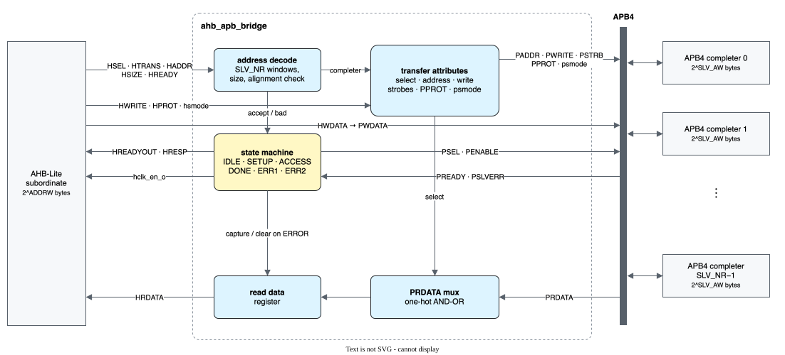
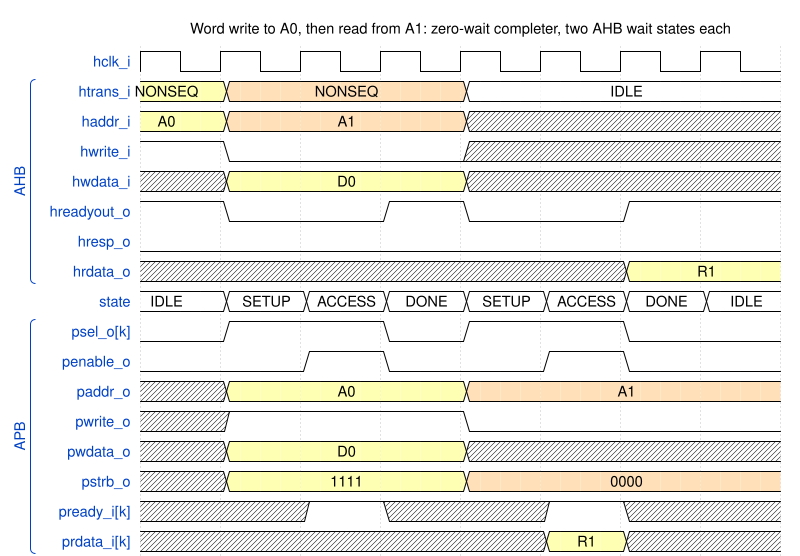
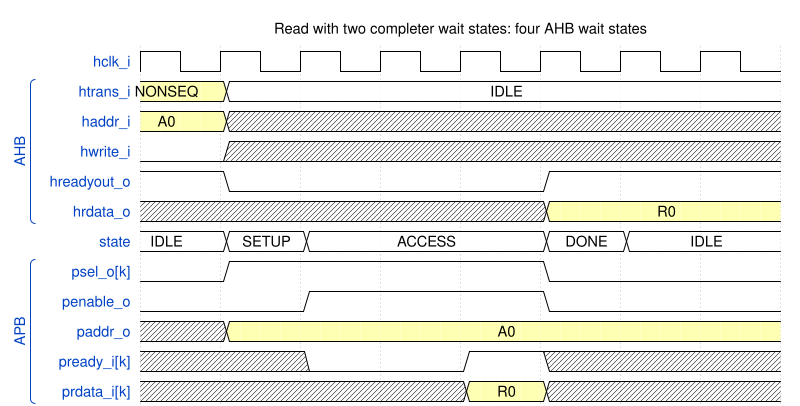
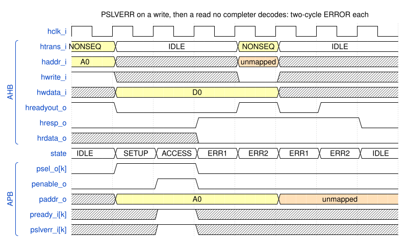

<p align="center">
  
</p>

# AHB to APB Bridge

*AHB-Lite subordinate driving up to sixteen APB4 completers, each in its own
power-of-two window. The AHB response comes from flops only, so the completers
stay off the AHB return path: the place for slow, simple peripherals.*

---

## Contents

- [Overview](#overview)
  - [Design parameters](#design-parameters)
  - [Address decoding](#address-decoding)
  - [Transfer outcomes](#transfer-outcomes)
- [Architecture](#architecture)
  - [Block diagram](#block-diagram)
  - [State machine](#state-machine)
  - [Timing](#timing)
  - [Protection and privilege](#protection-and-privilege)
- [Port summary](#port-summary)
- [Integration requirements](#integration-requirements)
- [Operation](#operation)
- [Repository layout](#repository-layout)
- [Verification](#verification)
- [Synthesis](#synthesis)
- [License](#license)

---

## Overview

One AHB transfer becomes one APB transfer. The bridge takes the AHB address
phase, decodes the completer, runs the APB SETUP phase in the first cycle of the
AHB data phase and the ACCESS phase until the completer's `PREADY`, then gives
the AHB response from flops in the next cycle. `HREADYOUT`, `HRESP` and
`HRDATA` are never a combinational function of `PREADY`, `PRDATA` or `PSLVERR`:
behind the bridge, however many completers there are and however slow their
read multiplexers, the AHB fabric sees a single subordinate with registered
outputs.

Writes are not posted: the response to a write is the completer's, so an APB
error reaches the AHB manager with the transfer that caused it. Every aRVern
manager marks its transfers non-bufferable (`HPROT[2]` = 0), for which the AHB
specification requires the write response to come from the final destination.
An aRVern hart takes the ERROR as a resumable NMI with the faulting address in
`marv_eaddr`.

`PCLK` is `HCLK`: the bridge and the completers share the clock. A divided or
asynchronous APB clock, or a `PCLKEN`, is not supported: power is saved by
gating the clock while a block is idle (see
[Integration requirements](#integration-requirements)), not by slowing it.

### Design parameters

| Parameter | Default | Range | Meaning |
|---|---|---|---|
| `SLV_NR` | 2 | 1 … 16 | number of APB completers |
| `ADDRW` | 12 | 4 … 31 | the bridge window is 2^`ADDRW` bytes; `haddr_i` and `paddr_o` are `ADDRW` bits |
| `SLV_BASE` | `{12'h100, 12'h000}` | — | completer *k*'s window base in `[k*ADDRW +: ADDRW]` |
| `SLV_AW` | `{5'd8, 5'd8}` | 2 … `ADDRW` each | completer *k*'s window is 2^`SLV_AW` bytes, in `[k*5 +: 5]` |
| `ASYNC_RST_EN` | 1 | 0, 1 | 1 asynchronous active-low reset, 0 synchronous reset |

A simulation build stops at elaboration with a message for an out-of-range
`SLV_NR`, `ADDRW` or `SLV_AW`, a base not aligned to its window, or two windows
that overlap (`$fatal` in generate blocks under `translate_off`). Synthesis
does not check them: an overlapping map synthesises into a `PSEL` that is not
one-hot, so run the map through simulation or lint first.

### Address decoding

Completer *k* answers the addresses whose bits above `SLV_AW[k]` equal those of
its base. Windows may leave gaps; an address in the bridge window that no
completer decodes gets the AHB ERROR response without any APB transfer.
`paddr_o` carries the full bridge-window address, low bits included: a
completer uses the bits of its own window.

### Transfer outcomes

| Case | APB | AHB response |
|---|---|---|
| Decoded address, aligned, size up to a word, completer answers `PSLVERR` = 0 | one transfer | OKAY, read data from `PRDATA` |
| Decoded address, completer answers `PSLVERR` = 1 | one transfer | ERROR (two cycles) |
| Address no completer decodes | none | ERROR (two cycles) |
| `HSIZE` wider than a word (3 … 7) | none | ERROR (two cycles) |
| Half-word at an odd address, or word with `HADDR[1:0]` ≠ 0 | none | ERROR (two cycles) |
| `HTRANS` IDLE or BUSY, or `HSEL` low | none | OKAY, zero wait states |

The ERROR response is the family's: `HREADYOUT` low with `HRESP` high, then
`HREADYOUT` and `HRESP` high. `HRDATA` is 0 in both cycles, whatever the
transfer's direction.

For firmware: exactly one APB transfer runs per accepted AHB transfer, and an
APB access is never repeated. An ERROR that started no APB transfer (no
completer, too wide, misaligned) changed nothing. An ERROR from `PSLVERR` may
have changed the completer: the APB specification leaves that to the
completer, and its document says what a failed access does.

---

## Architecture

### Block diagram



The address decode and the size and alignment checks run on the AHB address
phase; the state machine and the attribute register take over from the next
cycle. Only
registers drive the AHB outputs: the state for `HREADYOUT` and `HRESP`, the
read data register for `HRDATA`. `HWDATA` is the one AHB signal that goes
straight through, to `PWDATA`.

### State machine

| State | `HREADYOUT` | `HRESP` | APB | Next |
|---|---|---|---|---|
| `IDLE` | 1 | 0 | — | `SETUP` (accepted transfer), `ERR1` (no completer, too wide or misaligned), else `IDLE` |
| `SETUP` | 0 | 0 | `PSEL` = 1, `PENABLE` = 0 | `ACCESS` |
| `ACCESS` | 0 | 0 | `PSEL` = 1, `PENABLE` = 1 | `ACCESS` while `PREADY` is low; then `DONE` or `ERR1` (`PSLVERR`) |
| `DONE` | 1 | 0 | — | as `IDLE` |
| `ERR1` | 0 | 1 | — | `ERR2` |
| `ERR2` | 1 | 1 | — | as `IDLE` |

`IDLE`, `DONE` and `ERR2` are the cycles in which `HREADYOUT` is high, so the
next AHB address phase is taken there: back-to-back transfers need no idle
cycle between them. The state is a 3-bit binary register (reset `IDLE` = 0); the
transfer's completer select, address, direction, strobes and protection are
held in registers from the address phase to the end of the transfer. `PWDATA`
is `HWDATA` itself: an AHB manager holds the write data stable while
`HREADYOUT` is low, which spans SETUP and ACCESS. The read data register loads
`PRDATA` when a read ends without `PSLVERR` and clears when an ERROR response
starts. The two unused encodings (6 and 7) start no APB transfer and no ERROR,
hold `HREADYOUT` low, request the clock and return to `IDLE` at the next edge.

### Timing

| Transfer | AHB wait states (`HREADYOUT` low) |
|---|---|
| OKAY, completer with *n* wait states (`PREADY` low in ACCESS) | *n* + 2 |
| ERROR after `PSLVERR`, completer with *n* wait states | *n* + 3 |
| ERROR raised by the bridge (no completer, too wide, misaligned) | 1 |
| `HTRANS` IDLE or BUSY, or `HSEL` low | 0 |

An ERROR's first cycle counts as a wait state. The bench checks these counts on
every transfer.

### Protection and privilege

| APB | Source |
|---|---|
| `PPROT[0]` (privileged) | `HPROT[1]` |
| `PPROT[1]` (non-secure) | 0, Secure: the fabric carries no `HNONSEC`, so every transfer is presented as Secure |
| `PPROT[2]` (instruction) | `~HPROT[0]` |
| `psmode_o` | `hsmode_i`, the aRVern supervisor-mode sideband (the fabric's `HAUSER`), with the timing of `PPROT` |
| `pmaster_o` | `hmaster_i`, the manager ID (the fabric's `HMASTER`), with the timing of `PPROT` |

`{PPROT[0], psmode_o}` gives a completer the manager's privilege mode exactly as
`{HPROT[1], hsmode}` gives it to an AHB subordinate: `1,0` M-mode, `1,1`
S-mode, `0,x` U-mode. In APB5 terms `psmode_o` is a one-bit `PAUSER`, with the
same timing and stability rules. `pmaster_o` tells a completer which manager
made the transfer: the aRVern Debug Module tags its system-bus accesses with
`HMASTER` bit 3, so a completer with read side effects (a receive FIFO, for
example) can let a debugger read without disturbing it, as `apb_i2s` does. APB4
has no manager ID; in APB5 terms `pmaster_o` is part of `PAUSER`. `PSTRB` follows
`HSIZE` and `HADDR[1:0]` for writes and is 0 for reads.

The bridge filters no privilege level: it carries the manager's mode to the
completers unchanged, and a completer that must be protected checks it
itself, as the family's AHB subordinates do (`apb_periph_example`'s `MDELEG`,
`apb_gpio`'s `MDELEG`). A completer that ignores `PPROT` is open to
every mode: keep it out of reach of less-privileged code by other means, such
as a PMP region.

---

## Port summary

| Port | Dir | Width | Meaning |
|---|---|---|---|
| `hclk_i` | in | 1 | bridge and APB clock |
| `hresetn_i` | in | 1 | active-low reset, style per `ASYNC_RST_EN` |
| `hclk_en_o` | out | 1 | clock request for an external ICG: a transfer arriving or in flight |
| `haddr_i` | in | `ADDRW` | byte address in the bridge window |
| `hmaster_i` | in | 4 | manager ID (`HMASTER`) |
| `hprot_i` | in | 4 | protection ([0] data, [1] privileged; [3:2] not used) |
| `hready_i` | in | 1 | bus ready in |
| `hsize_i` | in | 3 | transfer size |
| `hsmode_i` | in | 1 | supervisor-mode sideband |
| `htrans_i` | in | 2 | transfer type |
| `hwdata_i` | in | 32 | write data |
| `hwrite_i` | in | 1 | write |
| `hsel_i` | in | 1 | subordinate select |
| `hrdata_o` | out | 32 | read data (registered; 0 during an ERROR response) |
| `hreadyout_o` | out | 1 | ready out (registered) |
| `hresp_o` | out | 1 | response (registered) |
| `psel_o` | out | `SLV_NR` | completer select, one-hot |
| `paddr_o` | out | `ADDRW` | address |
| `penable_o` | out | 1 | ACCESS phase |
| `pwrite_o` | out | 1 | write |
| `pwdata_o` | out | 32 | write data |
| `pstrb_o` | out | 4 | write strobes, 0 for reads |
| `pprot_o` | out | 3 | protection: {instruction, 0 = Secure, privileged} |
| `psmode_o` | out | 1 | supervisor-mode sideband |
| `pmaster_o` | out | 4 | manager ID, with `PPROT` |
| `prdata_i` | in | 32 · `SLV_NR` | completer *k*'s read data in `[k*32 +: 32]` |
| `pready_i` | in | `SLV_NR` | completer ready |
| `pslverr_i` | in | `SLV_NR` | completer error, valid with `PREADY` |

---

## Integration requirements

- **Clock.** The completers run on the bridge's clock, and two ICG
  arrangements are correct:
  - *One gate (reference).* An ICG enabled by `hclk_en_o` clocks the bridge
    and every completer. The completers' own clock requests (`pclk_en_o` on
    the family's APB IPs) stay unconnected: `hclk_en_o` is high from the
    address phase through SETUP, ACCESS and the response cycle, which covers
    them.
  - *One gate per completer.* The bridge on its ICG from `hclk_en_o`; each
    completer on its own ICG, fed by the ungated clock and enabled by its
    `pclk_en_o` (`PSEL`). A latch-based ICG passes the edge that ends a cycle
    in which its enable is high, so a completer selected in SETUP receives the
    edge ending SETUP and every ACCESS edge.

  In both, the SoC reset generator requests every clock during reset, so a
  synchronous reset completes through the gates. While the bridge is idle,
  `hclk_en_o` is combinational from `hsel_i`, `hready_i` and `htrans_i`: it
  must reach a latch-based ICG unregistered, so that the gate passes the edge
  that ends the address phase. A registered request would arrive one edge
  late, after the address phase is lost. A completer that needs its
  clock while the bridge is idle (a timer, an interface receiving data, an
  always-on input path) takes the ungated clock or requests its own.
- **Reset.** The completers' `PRESETn` is `hresetn_i`: the bridge and its
  completers reset together. A reset reaching only the bridge would leave a
  completer in ACCESS with no APB means to leave it; one reaching both loses
  the transfer in flight and nothing more. With `ASYNC_RST_EN` = 0 the bridge
  needs one clock edge in reset to reach its reset state (`PSEL` and
  `PENABLE` low, `HREADYOUT` high, OKAY, `HRDATA` 0); the reset generator's
  clock request during reset provides it.
- **Completers.** APB4: a completer drives `PREADY` (tie it high for a
  zero-wait completer), `PSLVERR` (tie it low if it never fails) and `PRDATA`
  for reads; `PRDATA` and `PSLVERR` matter only in the cycle with `PSEL`,
  `PENABLE` and `PREADY` high. A completer that filters by privilege reads
  `PPROT[0]` and `psmode_o`.
- **Windows.** Each completer's window is aligned to its size. Place the bridge
  in the system map with a decode window of 2^`ADDRW` bytes and connect the
  matching low address bits to `haddr_i`.
- **AHB.** The bridge is an AHB-Lite subordinate with the family's dialect
  (`hsmode_i` on `HAUSER`); an integrator without the sideband ties it to 0, and
  one without a manager ID ties `hmaster_i` to 0.
  Not supported, by design: bursts are taken beat by beat, each beat its own
  APB transfer; `HBURST`, `HMASTLOCK`, `HEXCL` and `HNONSEC` have no input;
  `HPROT[3:2]` (cacheable, bufferable) and `HTRANS[0]` are ignored, so a
  bufferable write is still not posted.

---

## Operation

A word write, then a read, to completers with no wait states:



The read's address phase is presented during the write's data phase and taken
in its `DONE` cycle, so the transfers run back to back. `PADDR`, `PWRITE` and
`PSTRB` keep their value after a transfer until the next address phase is
taken, a rejected one included; `HRDATA` keeps the last read data until the
next read or ERROR, and is 0 out of reset.

A completer that holds `PREADY` low stretches `ACCESS`, and the AHB transfer
with it:



A completer error, then an address in none of the windows: each ends in the
two-cycle ERROR response with `HRDATA` at 0, and the second starts no APB
transfer (`PSEL` stays low while the attribute register takes the rejected
address):



---

## Repository layout

```
ahb_apb_bridge/
  rtl/verilog/       ahb_apb_bridge.v, filelist.f
  bench/verilog/     tb_ahb_apb_bridge.v, ahb_master.v, apb_completer_model.v, submit.f
  sim/rtl_sim/       bin/ (flow scripts, rtl_configs.py, sim_configs.py), run/, src/ (tests)
  lint/vc_static/    VC Static signoff lint
  synthesis/synopsys Design Compiler flow
  doc/               this document; img/ holds the draw.io block diagram (editable SVG),
                     the WaveDrom sources (*.json), their SVG and render.py
```

---

## Verification

The bench drives the bridge from a queued AHB-Lite manager that issues every
address phase in the cycle the previous transfer completes, with APB completer
models (0 to *n* random wait states, `PSLVERR` on the last word of each window
wider than one word, random `PREADY` and `PSLVERR` wherever the bridge must
ignore them), bus stalls from other subordinates' data phases, an APB4
protocol checker (one-hot `PSEL`, SETUP before ACCESS, address, control and
data stable through a transfer, `PSTRB` 0 for reads, nothing in reset) and a
reference memory that predicts every read and every response, `HRDATA` at 0
during an ERROR included. On every transfer the manager also checks the wait
states of the [Timing](#timing) table, the ERROR's two cycles, and the SETUP's
`PADDR`, `PWRITE`, `PPROT`, `psmode_o` and `pmaster_o`; on every cycle, that `HRDATA` holds
between the reads and ERRORs that change it and that IDLE, BUSY and `HSEL` low
get a zero-wait OKAY. A bench option clocks the bridge and the completers
through a latch-based clock gate enabled by `hclk_en_o` alone (and by the reset
request during reset), the one-gate arrangement of
[Integration requirements](#integration-requirements), while the manager and
the checkers stay on the free-running clock.

```bash
cd sim/rtl_sim/run
./run <test>          # one test, default completer map
./run_all             # the regression on the default map
./run_all -sweep      # every test on every map (bin/sim_configs.py)
./run_all -cov        # Verilator line / branch / toggle coverage
./run_lint -sweep     # Verilator lint on every parameter set (bin/rtl_configs.py)
```

| Test | Checks |
|---|---|
| `simple_rdwr` | word write and read at the bottom and near the top of every window |
| `wait_states` | random completer wait states; AHB wait states = completer wait states + 2 |
| `strobes` | byte and half-word writes on every lane, read back at every size |
| `slverr` | `PSLVERR` on reads and writes, with and without wait states: two-cycle ERROR |
| `unmapped` | the window's gaps and the words around every window: ERROR, no APB transfer |
| `oversize` | `HSIZE` 3 … 7: ERROR, no APB transfer |
| `misaligned` | half-words at odd addresses and words off a word boundary, reads and writes, also too wide or unmapped: ERROR with `HRDATA` 0, no APB transfer, memory unchanged |
| `pipelined` | back-to-back transfers across completers, with ERRORs among them |
| `busy_idle` | selected IDLE and BUSY phases start nothing |
| `prot_smode` | `PPROT`, `psmode_o` and `pmaster_o` for machine, supervisor, user (with `hsmode_i` low and high) and instruction accesses, reads and writes, from several manager IDs (hart, debugger, and each `HMASTER` bit high and low) |
| `hsel_idle` | transfers with `HSEL` low start nothing |
| `reset_mid_transfer` | a reset in `SETUP`, `ACCESS`, `DONE`, `ERR1` or `ERR2` returns the bridge to idle with its outputs at their reset values |
| `clock_request` | `hclk_en_o` high while busy, low when idle and in reset; the unused state encodings request the clock and return to `IDLE` |
| `random_traffic` | 2000 random transfers, sizes (illegal and misaligned ones included), gaps, phases and wait states |
| `data_walk` | walking ones and zeros through every completer |
| `bus_stall` | another subordinate's data phases hold `HREADY` low while an address phase to the bridge waits: no transfer starts before `HREADY` is high, one APB transfer per AHB transfer |

The sweep runs the sixteen tests on ten configurations: four completer maps
(three completers with gaps, one completer owning the window, sixteen
completers, the gapped map with a one-word completer), each in both reset
styles, and the default map on the gated clock in both reset styles, with
twenty functional cover bins that must all be hit. Coverage is
100 % of lines, branches and toggles, with two toggle points waived as constant
by construction (`PPROT[1]`).

---

## Synthesis

The Design Compiler flow lives under `synthesis/synopsys/` and uses the
family's `LIB_FLAVOR` mechanism. `libraries/setup_lib_default.tcl` names your
technology: create it from the tracked `setup_lib_example.tcl` before the first
run.

```bash
cd synthesis/synopsys
./run_syn                          # default flavor (lib_default)
./run_syn -rtl_config <N|name>     # one entry of sim/rtl_sim/bin/rtl_configs.py
./run_syn -rtl_sweep               # every entry
./run_check_reset_style            # every flop of the netlist in the expected reset style
```

The default configuration (two completers) is about 0.8 kGates (NAND2
equivalent), most of it the registers holding the read data and the
transfer's attributes.

---

## License

BSD 3-Clause — see [`LICENSE`](../../LICENSE) at the repo root.
