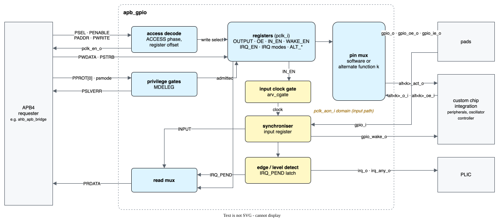
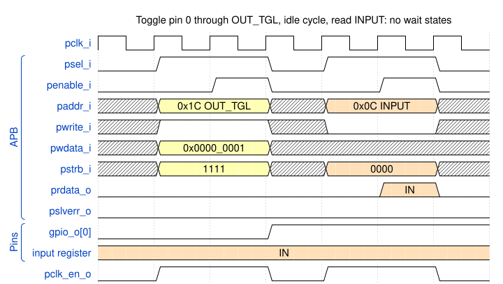
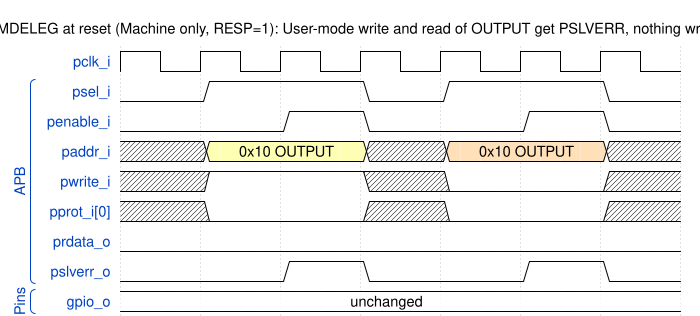

<p align="center">
  
</p>

# apb_gpio

*General-purpose I/O with per-pin edge and level interrupts, on an APB4 completer port.*

`apb_gpio` drives and samples up to 32 pins. Each pin has an output value, an output
enable and a synchronised input, and can raise an interrupt on a rising edge, a falling
edge, a high level or a low level, in any combination. Every pin has its own interrupt
line, ready to be wired to a PLIC source, and one combined line serves SoCs that route
the block to a single interrupt input.

The pads are outside the IP: it provides `gpio_o`, `gpio_oe_o` and `gpio_ie_o` and takes
`gpio_i`, so the integrator chooses the pad cells and the bidirectional buffers. Pull-ups,
pull-downs, drive strength, slew rate and Schmitt inputs are not controlled here: they
belong to the SoC's pad controller, or to the constraints file on an FPGA, where they are
fixed when the bitstream is built. Optionally, up to four alternate functions per pin (an
SPI, UART or I2C signal, for example) can take over a pin's output under software control.

The input path runs on the free-running clock, so pins are watched while the bus clock is
gated, and an asynchronous wake request restarts a stopped oscillator when a pin
changes in a direction its interrupt modes report. Access is gated by privilege level
with an `MDELEG` register, as in
[`apb_periph_example`](../../apb_periph_example/doc/apb_periph_example.md).

The bus port is APB4, for a place behind
[`ahb_apb_bridge`](../../ahb_apb_bridge/doc/ahb_apb_bridge.md) with the other slow
peripherals.



---

## Parameters

| Parameter | Default | Range | Meaning |
|---|---|---|---|
| `GPIO_NR` | `32` | 1–32 | Number of pins. Register bits above `GPIO_NR-1` read 0 and ignore writes. |
| `ADDRW` | `7` | 7–16 | APB address width; the register window is `1 << ADDRW` bytes. 7 is the smallest window that holds the map, which ends with `MDELEG` at `0x60`; 16 is a sanity cap. |
| `SYNC_EN` | `1` | 0, 1 | `1`: each `gpio_i` bit crosses a two-stage synchroniser (asynchronous pins). `0`: `gpio_i` comes from an on-chip source already synchronous to `pclk_aon_i`, never from a pad, and is registered once. |
| `MDELEG_RST` | `9'h10F` | see *Access protection* | Reset value of `MDELEG[8:0]`. The default admits Machine mode only and answers any other access with `PSLVERR`; `9'h000` comes out of reset open to every mode, with refused accesses dropped silently. A field may not hold the reserved code `2'b10`, and bits `[7:4]` must be 0. |
| `ALT_NR` | `0` | 0–4 | Alternate functions per pin (see *Alternate functions*). Functions `ALT_NR` and above are absent: their `alt<k>_*` inputs are unused and `alt<k>_act_o` reads 0. `0`: no `ALT_*` register. |
| `INP_CGATE_EN` | `1` | 0, 1 | `1`: the input path runs on `pclk_aon_i` through an internal clock gate (see *Clocks*). `0`: no gate, the input path runs on `pclk_aon_i` directly (FPGA, or no low-power need). Behaviour is identical. |
| `ASYNC_RST_EN` | `1` | 0, 1 | Reset style: `1` asynchronous active-low, `0` synchronous. Behaviour is identical. |

An illegal `GPIO_NR`, `ADDRW`, `SYNC_EN`, `ALT_NR`, `INP_CGATE_EN`, `ASYNC_RST_EN` or
`MDELEG_RST` stops simulation and lint elaboration. The checks sit inside
`translate_off`, so synthesis does not see them.

---

## Ports

| Port | Dir | Width | Meaning |
|---|---|---|---|
| `pclk_i` | in | 1 | Bus clock, may be gated by an external ICG driven by `pclk_en_o` |
| `pclk_aon_i` | in | 1 | Free-running clock: the oscillator output, upstream of every ICG; stops only when the oscillator stops (see *Clocks*) |
| `presetn_i` | in | 1 | Active-low reset for both clocks, style per `ASYNC_RST_EN`; de-assertion synchronous to `pclk_aon_i` |
| `pclk_en_o` | out | 1 | Bus clock request for the external ICG (see *Clocks*) |
| `scan_mode_i` | in | 1 | Test mode: forces the internal input-path clock gate open (tie 0 in function; unused with `INP_CGATE_EN=0`) |
| `psel_i` | in | 1 | Completer select |
| `penable_i` | in | 1 | ACCESS phase |
| `paddr_i` | in | `ADDRW` | Byte address; bits `[1:0]` not used |
| `pwrite_i` | in | 1 | Write |
| `pwdata_i` | in | 32 | Write data |
| `pstrb_i` | in | 4 | Write strobes; not used on reads |
| `pprot_i` | in | 3 | `pprot_i[0]` = privileged; `[2:1]` not used |
| `psmode_i` | in | 1 | aRVern S-mode sideband, with the timing of `PPROT` |
| `prdata_o` | out | 32 | Read data, in the ACCESS cycle of an admitted read; 0 otherwise |
| `pready_o` | out | 1 | Always 1 |
| `pslverr_o` | out | 1 | Error: an access `MDELEG` refuses while `RESP=1`, in its ACCESS cycle |
| `gpio_i` | in | `GPIO_NR` | Pin input values |
| `gpio_o` | out | `GPIO_NR` | Pin output values (`OUTPUT`, or the selected alternate function) |
| `gpio_oe_o` | out | `GPIO_NR` | Pin output enables (`OE`, or the selected alternate function), 1 = drive |
| `gpio_ie_o` | out | `GPIO_NR` | Pin input enables: `IN_EN`, for a pad's receiver enable (see *Inputs*) |
| `alt0_o_i` … `alt3_o_i` | in | `GPIO_NR` | Output values of alternate function 0 … 3, bit `n` = pin `n` |
| `alt0_oe_i` … `alt3_oe_i` | in | `GPIO_NR` | Output enables of alternate function 0 … 3, 1 = drive |
| `alt0_act_o` … `alt3_act_o` | out | `GPIO_NR` | Alternate function 0 … 3 currently owns pin `n` |
| `irq_o` | out | `GPIO_NR` | Per-pin interrupt: `IRQ_PEND[n] & IRQ_EN[n]` |
| `irq_any_o` | out | 1 | OR of `irq_o` |
| `gpio_wake_o` | out | 1 | Asynchronous wake request (see *Wake*) |

The `alt<k>_*` ports exist whatever `ALT_NR`, because Verilog-2001 cannot make a port
conditional; tie the inputs of absent or unused functions to 0. `gpio_o`, `gpio_oe_o` and
`gpio_ie_o` are register outputs for a pin under software control; `gpio_o` and
`gpio_oe_o` pass the selected `alt<k>_o_i` / `alt<k>_oe_i` bit through one AND-OR mux for
a pin handed to an alternate function. `irq_o` and `irq_any_o` are AND-OR functions of
registers: stable levels for a consumer clocked by the free-running clock `pclk_aon_i`
is, such as a PLIC gateway (`ahb_plic` requires its sources on that clock, never on its
own gated `hclk_i`), but not glitch-free for an asynchronous one. `gpio_wake_o` is
combinational from `gpio_i`; it is not an APB `PWAKEUP` and is never sampled by a clock
(see *Wake*).

---

## Register map

All registers are 32 bits. Bit `n` is pin `n`. A write updates only the byte lanes
`PSTRB` selects (behind the bridge, the lanes of a byte or half-word store); reads always
return the whole word. Offsets not listed read 0 and ignore writes.

| Offset | Name | Access | Reset | Meaning |
|---|---|---|---|---|
| `0x00` | `INFO` | RO | — | Pin mask: bits `[GPIO_NR-1:0]` set, other bits 0 |
| `0x04` | `IN_EN` | RW | `0` | Input enable: the pin is sampled (see *Inputs*) |
| `0x08` | `OE` | RW | `0` | Output enables, driven on `gpio_oe_o` |
| `0x0C` | `INPUT` | RO | `0` | Pin values after the input stage (see *Inputs*) |
| `0x10` | `OUTPUT` | RW | `0` | Output values, driven on `gpio_o` |
| `0x14` | `OUT_SET` | WO | — | Writing 1 sets the `OUTPUT` bit; reads 0 |
| `0x18` | `OUT_CLR` | WO | — | Writing 1 clears the `OUTPUT` bit; reads 0 |
| `0x1C` | `OUT_TGL` | WO | — | Writing 1 inverts the `OUTPUT` bit; reads 0 |
| `0x20` | `IRQ_EN` | RW | `0` | Interrupt enable: gates `IRQ_PEND` onto `irq_o` |
| `0x24` | `IRQ_PEND` | RW1C | `0` | Pending interrupts (see *Interrupts*) |
| `0x28` | `WAKE_EN` | RW | `0` | Wake enable: a change on the pin raises `gpio_wake_o` (see *Wake*) |
| `0x2C` | `CFG` | RO | — | Build parameters (see below) |
| `0x30` | `IRQ_RISE` | RW | `0` | Latch a rising edge into `IRQ_PEND` |
| `0x34` | `IRQ_FALL` | RW | `0` | Latch a falling edge into `IRQ_PEND` |
| `0x38` | `IRQ_HIGH` | RW | `0` | Report a high level in `IRQ_PEND` |
| `0x3C` | `IRQ_LOW` | RW | `0` | Report a low level in `IRQ_PEND` |
| `0x40` | `ALT_EN` | RW | `0` | 1 = the pin is driven by its alternate function (`ALT_NR` ≥ 1) |
| `0x44` | `ALT_SEL0` | RW | `0` | Alternate function number, bit 0 (`ALT_NR` ≥ 2) |
| `0x48` | `ALT_SEL1` | RW | `0` | Alternate function number, bit 1 (`ALT_NR` ≥ 3) |
| `0x4C` | `IRQ_STAT` | RO | `0` | `IRQ_PEND & IRQ_EN`: the pending interrupts that drive `irq_o` |
| `0x50` | `OE_SET` | WO | — | Writing 1 sets the `OE` bit; reads 0 |
| `0x54` | `OE_CLR` | WO | — | Writing 1 clears the `OE` bit; reads 0 |
| `0x58` | `IRQ_EN_SET` | WO | — | Writing 1 sets the `IRQ_EN` bit; reads 0 |
| `0x5C` | `IRQ_EN_CLR` | WO | — | Writing 1 clears the `IRQ_EN` bit; reads 0 |
| `0x60` | `MDELEG` | RW (M-mode only) | `MDELEG_RST` (`0x0000_010F`) | Privilege gates (see *Access protection*) |

A register whose `ALT_NR` condition is not met is absent: it reads 0 and ignores writes,
like an unlisted offset.

`OUT_SET`, `OUT_CLR`, `OUT_TGL`, `OE_SET`, `OE_CLR`, `IRQ_EN_SET` and `IRQ_EN_CLR` change
individual pins without a read-modify-write, so an interrupt handler and the main program
can drive, turn around or mask different pins of the same port safely. The other RW
registers (`IN_EN`, `WAKE_EN`, the mode registers, the `ALT_*` registers) are written
whole: code that changes them from two contexts serialises the read-modify-write.

**Open-drain pins** use `OE`, not a dedicated mode: keep `OUTPUT[n]` at 0, then
`OE_SET` pulls the line low and `OE_CLR` releases it to the external pull-up. With
`IN_EN[n]` set, `INPUT[n]` reads the line itself, as an I2C or 1-Wire master needs for
clock stretching and arbitration.

**`CFG`** holds build parameters that software cannot otherwise see:

| Bits | Field | Value |
|---|---|---|
| `[2:0]` | `ALT_NR` | The `ALT_NR` parameter, 0–4 |
| `[3]` | — | 0 |
| `[4]` | `SYNC_EN` | The `SYNC_EN` parameter: `INPUT` latency 3 edges (1) or 1 edge (0) |
| `[5]` | `INP_CGATE_EN` | The `INP_CGATE_EN` parameter |
| `[27:6]` | — | 0 |
| `[31:28]` | `VERSION` | `1`, the register map described here |

`GPIO_NR` is in `INFO`; `ADDRW` and `ASYNC_RST_EN` change nothing software sees, and
`MDELEG_RST` is the value `MDELEG` reads after reset.

---

## Inputs

A pin is sampled only while its `IN_EN` bit is 1. Its input stage runs on `pclk_aon_i`,
so it follows the pin whether or not the bus clock is gated. With `SYNC_EN=1` a pin change
appears in `INPUT` three `pclk_aon_i` edges after it settles at `gpio_i` (two synchroniser
stages and the input register); with `SYNC_EN=0`, one edge. Edge detection compares the
input register with its value one cycle earlier, so a pulse is seen only if it stays
stable for at least one `pclk_aon_i` period at the sampling point; shorter pulses may be
missed. Pins are sampled whatever their `OE`, so a driven pin reads back its own output
(through the pad).

What reaches `INPUT` depends on the clock and the pin:

| Condition | A pin change is recorded |
|---|---|
| Oscillator running | Always, if the level holds for at least one `pclk_aon_i` period at the sampling point; a shorter pulse may be missed |
| Oscillator stopped | Only if it persists until the clock is back and the input stage has sampled it: the oscillator's start-up time plus three `pclk_aon_i` edges (one with `SYNC_EN=0`). It can still raise the wake request (see *Wake*) |
| `IN_EN[n]=0` | Never: the pin is not watched |

There is no digital filter: a bouncing contact is debounced in software.

**`gpio_ie_o`** mirrors `IN_EN`, for a pad whose input receiver has an enable. A receiver
left enabled on a floating pin draws current, the usual deep-sleep leak, so a pad that
follows `gpio_ie_o` stops receiving on every pin software does not watch. Peripheral
inputs take the pad directly (see *Alternate functions*), so on such a pad a pin that
feeds a peripheral input needs `IN_EN[n]=1` too. Leave a pad's receiver enable tied on
if that coupling is not wanted.

**Disabled pins.** While `IN_EN[n]=0` the pin's input register is held at 0: `INPUT[n]`
reads 0, and the pin raises no edge, no level and no wake request. Its synchroniser keeps
sampling whenever the input-path clock runs (no logic sits in front of a synchroniser), but
nothing it holds is used until the pin is enabled and flushed. A latched edge in
`IRQ_PEND[n]` survives clearing `IN_EN[n]` and stays until software clears it.

**Enabling a pin.** When `IN_EN[n]` is set, the pin's input stage is first flushed: its
first samples reach the input register after the stage depth (three `pclk_aon_i` cycles
with `SYNC_EN=1`, one with `SYNC_EN=0`). Until then `INPUT[n]` reads 0 and no level is
reported; edge detection starts one cycle later, once the previous sample is a real one
too. Enabling a pin therefore never reports the step from the held 0 to the pin's level,
and a pin change after that is reported normally. Each pin flushes on its own: enabling
one pin does not disturb the others. Clearing `IN_EN[n]` stops the pin at once.

---

## Interrupts

For each pin the IP builds two kinds of condition from the input register:

- **Edges.** A rising edge with `IRQ_RISE[n]=1`, or a falling edge with `IRQ_FALL[n]=1`,
  **sets** the latched bit of `IRQ_PEND[n]`. It stays set until software writes 1 to it.
  A write of 1 in the same cycle as a new edge on that pin leaves the bit set: the new
  event is not lost.
- **Levels.** `IRQ_HIGH[n]=1` and the pin high, or `IRQ_LOW[n]=1` and the pin low, make
  `IRQ_PEND[n]` read 1 for as long as the condition holds. A level is not latched: writing
  1 does not clear it, and it disappears when the pin changes or the mode bit is cleared.

`IRQ_PEND[n]` reads the OR of the latched edge bit and the live level condition. Pending
bits are recorded whether or not `IRQ_EN[n]` is set; `IRQ_EN` only gates them onto
`irq_o[n]` and `irq_any_o`. Enabling an interrupt whose bit is already pending raises the
line at once. `IRQ_STAT` reads `IRQ_PEND & IRQ_EN`, the bits that drive `irq_o`.

An edge mode and a level mode may both be set on one pin. While the level holds it hides
the latched bit in `IRQ_PEND`, so a write of 1 to that bit cannot be confirmed by reading
it back until the level goes.

Writing a mode register does not create an event: turning on `IRQ_RISE` while a pin is
already high sets nothing; the next rising edge does. Only enabled pins (`IN_EN`) raise
events; edges and levels of a pin are recorded while its bus clock is gated, since the
pending latch also runs on `pclk_aon_i`.

**Handler sequence** (edge interrupts): read `IRQ_STAT`, write the bits handled to
`IRQ_PEND`, act on them. The write takes effect at the end of its ACCESS cycle, and
`irq_o` drops on the same clock edge. Writing back all of `IRQ_PEND` as read would also
clear the latched edges of pins whose interrupt is disabled, which software may be
polling. A level interrupt is cleared by removing its cause (the pin, or the mode bit).

**With a PLIC**, wire `irq_o[n]` to source inputs: the PLIC gateway takes the line as a
level and re-pends after `complete` as long as it stays high, so the handler clears
`IRQ_PEND` (or the level cause) before completing. There are three ways to wire the
block:

- **Every pin its own source:** the PLIC's `NUM_SOURCES` must leave room for `GPIO_NR`
  sources besides the other peripherals' (`ahb_plic`'s default 31 does not, for a 32-pin
  instance).
- **`irq_any_o` alone:** one source; the handler finds the pins in `IRQ_STAT`.
- **A subset of pins per source:** wire only those `irq_o` bits, and leave `irq_any_o`
  unconnected, since it would report the same pins again. The other pins are then
  polled.

---

## Alternate functions

With `ALT_NR` > 0 each pin has `ALT_NR` alternate-function slots. Alternate function `k`
has its own `GPIO_NR`-wide ports `alt<k>_o_i`, `alt<k>_oe_i` and `alt<k>_act_o`: the
integrator wires a peripheral signal into bit `n` to offer it on pin `n`, and ties unused
bits to 0 (synthesis removes their logic):

```verilog
.alt0_o_i  (spi_o_vec ),  .alt0_oe_i (spi_oe_vec ),   // function 0
.alt1_o_i  (uart_o_vec),  .alt1_oe_i (uart_oe_vec),   // function 1
.alt2_o_i  (i2c_o_vec ),  .alt2_oe_i (i2c_oe_vec ),   // function 2
.alt3_o_i  ({GPIO_NR{1'b0}}), .alt3_oe_i ({GPIO_NR{1'b0}}),
```

A peripheral output drives `alt<k>_oe_i` = 1; an open-drain one (I2C) drives `alt<k>_o_i` = 0
and `alt<k>_oe_i` = "pull low"; a slot that only feeds a peripheral input drives both 0.

**Selection.** The function number of pin `n` is `{ALT_SEL1[n], ALT_SEL0[n]}` (the absent
bits read 0, so it is 0 with `ALT_NR=1`). While `ALT_EN[n]=0` the pin is under software
control (`OUTPUT`, `OE`). While `ALT_EN[n]=1` and its function number `k` is below
`ALT_NR`, `gpio_o[n]` and `gpio_oe_o[n]` follow `alt<k>_o_i[n]` and `alt<k>_oe_i[n]`; a
function number of `ALT_NR` or more (only possible with `ALT_NR=3`, value 3: with fewer
functions the missing select bits read 0) selects nothing and the pin is not
driven (`gpio_oe_o[n]=0`, `gpio_o[n]=0`). `alt<k>_act_o[n]` is 1 while function `k`
owns pin `n`.

**Switching.** Set the function number while `ALT_EN` is 0 for those pins, then hand them
over with one write to `ALT_EN`: the pins go straight from `OUTPUT`/`OE` to the chosen
function. A write to `ALT_EN`, `ALT_SEL0` or `ALT_SEL1` takes effect at the end of its ACCESS
cycle: `gpio_o`, `gpio_oe_o` and `alt<k>_act_o` change on that clock edge. Changing
`ALT_SEL0`/`ALT_SEL1` while `ALT_EN` is 1 therefore switches at once and, since the
two registers are written separately, may select another function for the cycles in
between. At reset every pin is under software control. Switching a pin from one function
to another therefore clears its `ALT_EN` bit first, so for a few cycles it is driven by
`OUTPUT` and `OE` (the driver does this).

**Inputs.** Peripheral inputs take the pad (`gpio_i`) directly, not `INPUT`: they
synchronise on their own clock. To hold an input at its idle level while its pin belongs
to another function or to software, gate it with `alt<k>_act_o`, for example
`uart_rx = alt1_act_o[1] ? gpio_i[1] : 1'b1`. The GPIO input path is not affected
by `ALT_EN`: with `IN_EN` set, `INPUT`, the interrupts and the wake request still follow a
handed-over pin. A UART receive pin with `IRQ_FALL` can wake the system on its start bit,
which is over before a stopped oscillator is back: that needs the SoC's wake hold
(see *Wake*).

**Software registers.** `OUTPUT` and `OE` keep their value and stay writable (including
through `OUT_SET`, `OUT_CLR`, `OUT_TGL`) while a pin is handed over, and take effect again
when `ALT_EN[n]` returns to 0.

The alternate path needs no clock: the mux selects are registers, and a running peripheral
reaches the pins while the GPIO bus clock is gated.

---

## Clocks

`pclk_aon_i` and `pclk_i` are one clock, before and after the bus-side ICG: the two
domains are synchronous, nothing crosses between them by handshake, and the SDC declares
them as the same clock.

| Clock | Source | Stops | While stopped |
|---|---|---|---|
| `pclk_aon_i` | The free-running oscillator output, upstream of every ICG: the hart's, the bridge's and this IP's bus gate | Only when the SoC stops the oscillator for deep sleep | The input register keeps the last sample, which is the wake reference |
| `pclk_i` | `pclk_aon_i` through the SoC's ICG, driven by `pclk_en_o` | Whenever the completer is not selected, and with `pclk_aon_i` | The registers hold their values |

`pclk_aon_i` must not be taken after any other gate. `irq_o` feeds the PLIC, which
requires its sources on the free-running clock, and in a bridge topology where `pclk_i`
is the bridge's `hclk_i`, "before the bus gate" could otherwise name a clock that is
itself gated.

- **`pclk_aon_i`** clocks the input stage, the edge detector, the pending latch and
  `irq_o`. Internally it passes through a clock gate (`arv_cgate`) that is open while any
  `IN_EN` bit is set, for one more cycle after the last one is cleared (so the flush state
  empties), during a write to `IRQ_PEND` (so a latched edge can be cleared with every input
  off), during reset with `ASYNC_RST_EN=0`, and whenever `scan_mode_i` is 1. A block with no
  enabled input draws no input-path clock. With `INP_CGATE_EN=0` there is no gate and
  `scan_mode_i` has no effect; behaviour is the same, only the input path keeps clocking.
  One gate covers every pin: a single enabled pin keeps all `GPIO_NR` input stages
  clocked.
- **`pclk_i`** clocks the bus interface and the registers. `pclk_en_o` requests it while
  the completer is selected (`PSEL`, SETUP and ACCESS). During reset the SoC reset
  generator requests the bus clock, so a synchronous reset completes through the ICG; the
  input-path gate, inside the IP, opens on its own.

**Why the input-path gate is inside the IP.** Every other IP of the family exports a clock
request and leaves the gate to the SoC (`arv_primitives.md` lists this gate as the one
exception). Here the request combines the `IN_EN` bits, the flush state and a write to
`IRQ_PEND`, and must also open during a synchronous reset; the SoC reset generator
requests the clocks it gates, but cannot reach a gate it does not know about. Keeping the
gate inside makes the always-on path one self-contained block with one clock input, at
the cost of `scan_mode_i` and of the reset term in its enable, the only clock request in
the library that carries one.

While the oscillator runs, the input path keeps running when the bus clock is gated:
`INPUT` is current for enabled pins and edges are not missed during bus idle periods.
When the oscillator stops, the IP needs no warning: it keeps its state across the stop
(the input register is the reference the wake compares against) and has nothing to reset
first, so it has no announcement input, unlike `ahb_aclint`'s `hclk_aon_en_i`. After the
restart `INPUT` is current from the third `pclk_aon_i` edge (the first with
`SYNC_EN=0`).

---

## Wake

`gpio_wake_o` requests the oscillator back when a wake-enabled pin changes while the clock is
stopped, in a direction the pin's interrupt modes report:

```
rise[n]     = gpio_i[n] & ~in[n] & (IRQ_RISE[n] | IRQ_HIGH[n] | none[n])
fall[n]     = ~gpio_i[n] & in[n] & (IRQ_FALL[n] | IRQ_LOW[n]  | none[n])
gpio_wake_o = OR over n of  WAKE_EN[n] & IN_EN[n] & flushed[n] & (rise[n] | fall[n])
```

`in[n]` is the input register and `none[n]` is 1 when the pin has no mode bit set, so such
a pin wakes on any change. A pin set up for a rising edge does not wake on a falling one,
so a wake always has a change behind it that the pin's modes report once the clock runs.

When the oscillator stops, the input register keeps the last sampled value. A change on a
pin with `WAKE_EN` and `IN_EN` set then makes the pin differ from it and raises `gpio_wake_o`
with no clock. Once the clock runs again the change crosses the input stage, the input
register catches up, `gpio_wake_o` drops, and the change is reported like any other: as an
edge in `IRQ_PEND` if the pin's modes ask for it. A pin whose stage is still flushing
(see *Inputs*) does not request a wake. While the clock runs, `gpio_wake_o` also pulses
for a few cycles after every such change.

### Connecting the wake request

`gpio_wake_o` holds itself only until the GPIO has sampled the change: for a change that
persists it drops once the input register has caught up, three `pclk_aon_i` edges after
the clock returns (one with `SYNC_EN=0`); for a change that reverts it drops as soon as the
pin goes back. Any pulse on `arv_osc_ctrl.wake_i` restarts the oscillator and keeps it
running for four edges after the pulse ends, two of preset release and the two-edge stop
sequence (*The wake contract* in `arv_primitives.md`), so no pulse can leave the
oscillator stopped with a request pending. What the SoC adds in front of `wake_i` depends
on which events must wake the system.

**Direct connection, for changes that persist.** `gpio_wake_o` goes to `wake_i` (ORed with
the other wake sources). A change that is still there when the input stage samples it is
recorded in `INPUT` and `IRQ_PEND`, and its interrupt must then claim the clock before
`arv_osc_ctrl` stops it. Counting from the restart with `SYNC_EN=1` and an edge mode:

| `pclk_aon_i` edge | GPIO | `arv_osc_ctrl` |
|---|---|---|
| 3 | the input register takes the change, `gpio_wake_o` falls | the preset starts to release |
| 4 | `IRQ_PEND` sets, `irq_o` rises | |
| 5 | | the preset is released |
| 6 | | `announce` samples `enable_i` |
| 7 | | `run` samples `announce \| enable_i` |

`enable_i` therefore has to rise by edge 7, at most two registers after `irq_o`: the PLIC
gateway and one more. With that extra register `announce` falls at edge 6 and `clk_en_o`
dips for one cycle, but `run` keeps the oscillator going; a third register lets it stop.
With `SYNC_EN=0` every row moves two edges earlier and the budget is the same. A level
mode raises `irq_o` one edge sooner. The chain also needs the PLIC enable and priority and
the hart's `mie` to admit the pin. A change that reverts before the input stage has seen
it (the oscillator's start-up time plus three edges: microseconds for an RC oscillator,
milliseconds for a crystal) is lost: the oscillator runs its few edges, nothing is
recorded, and it stops again.

**Through a wake hold, for short events.** A UART start bit, a button bounce or a short
sensor pulse is over before the clock is back. To catch one, the SoC holds the request in
front of `wake_i`:

- **Set** asynchronously by `gpio_wake_o`. The hold records an event in an interval with
  no clock edges, so its set cannot be synchronous; its release is synchronised to the
  oscillator clock, as `arv_osc_ctrl`'s own preset is.
- **Cleared by software**, after the woken hart has looked at it. The hold also reaches
  the hart as an interrupt or a status bit, since a change that reverted leaves nothing
  else behind.

The oscillator then stays up until software has seen the wake, and the request path has
no edge budget. The GPIO still records the change (in `INPUT` and `IRQ_PEND`) only if it
persists past the sampling bound, so the hold, not `IRQ_PEND`, is what tells software that
a short event woke it.

`gpio_wake_o` is a combinational function of the pads and can glitch. It goes only to
`arv_osc_ctrl.wake_i` or the SoC's asynchronous, set-dominant hold, never to synchronous
logic, and is a false path for timing. It is not an APB `PWAKEUP`, which the APB
specification requires to be glitch-free for a different-domain sampler.

---

## Bus interface

Every transfer completes in its first ACCESS cycle (`PREADY` is always high). APB holds
the address, control and write data stable from SETUP to the end of ACCESS, so the IP
decodes the transfer straight from the bus: a write takes effect on the clock edge that
ends its ACCESS cycle, and `PRDATA` and `PSLVERR` are driven in that cycle and are 0 at
any other time. While `PSEL` is low the bus is ignored.



A write to `OUT_TGL`, then a read of `INPUT`: `gpio_o` changes on the edge that ends the
write's ACCESS cycle, and `PRDATA` carries the input register in the read's ACCESS cycle.



With `MDELEG` at its default value, a User-mode write and read: `PSLVERR` in each ACCESS
cycle, nothing written, `PRDATA` 0.

To regenerate the waveform SVGs, run `python3 render.py` in `doc/img/`; the block diagram
is a draw.io file embedded in its SVG.

---

## Access protection

Neither `ahb_apb_bridge` nor the fabric filters privilege: the IP does, with the
`MDELEG` register at `0x60`, the model and layout of
[`apb_periph_example`](../../apb_periph_example/doc/apb_periph_example.md#mdeleg-register-layout).

```
 31                 9    8    7              4    3       2    1       0
+--------------------+------+----------------+------------+------------+
|     reserved (0)   | RESP |  reserved (0)  |  RD_PRIV   |  WR_PRIV   |
+--------------------+------+----------------+------------+------------+
```

| Field | Bits | Reset | Description |
|---|---|---|---|
| `WR_PRIV` | `[1:0]` | `MDELEG_RST[1:0]` (`2'b11`) | Minimum privilege level for a write (at any offset but `MDELEG`). `00` = User, `01` = Supervisor, `10` = *reserved*, `11` = Machine. |
| `RD_PRIV` | `[3:2]` | `MDELEG_RST[3:2]` (`2'b11`) | Minimum privilege level for a read (at any offset but `MDELEG`). Same encoding. |
| `RESP` | `[8]` | `MDELEG_RST[8]` (`1'b1`) | `1`: a refused access gets `PSLVERR`. `0`: it is dropped silently. |
| reserved | `[7:4]`, `[31:9]` | `0` | Read 0; writes ignored. |

The requester's level comes from `pprot_i[0]` and `psmode_i`, as `ahb_apb_bridge` drives
them: `0,x` is User (0), `1,1` Supervisor (1), `1,0` Machine (3). An access is admitted
when its level is at least the gate's (`WR_PRIV` for a write, `RD_PRIV` for a read), at
every offset of the window, unmapped and read-only ones included. `PPROT[2:1]` are not
used. One pair of gates covers every pin: the block has one owner at a time.

A refused access changes nothing, reads 0 and, with `RESP=1`, gets `PSLVERR` in its
ACCESS cycle. Behind `ahb_apb_bridge` the `PSLVERR` becomes the AHB ERROR of the
transfer, which an aRVern hart takes as a resumable data-bus NMI, in Machine mode. When an
S-mode kernel gives the pins to U-mode tasks, Machine-mode firmware therefore clears
`RESP`, so their refused accesses are dropped instead.

**`MDELEG` itself** is Machine mode only, whatever the gates; a refused access to it
follows `RESP` like any other. A field written with the reserved code `2'b10` stores
`2'b11`. `PSTRB[0]` updates both gates, `PSTRB[1]` updates `RESP`, `PSTRB[3:2]` nothing.
A new value is in force from the next transfer. There is no lock bit.

With the default `MDELEG_RST` only Machine mode may access the block after reset.
Machine-mode firmware opens it by lowering the gates; a build that must come out of
reset open, an FPGA board running everything in Machine mode for example, sets
`MDELEG_RST = 9'h000` instead.

---

## Software

`sw/` holds the register map (`apb_gpio_regs.h`) and a driver (`apb_gpio.h`,
`src/apb_gpio.c`, functions prefixed `apb_gpio_`): input and wake enables, pin direction
and output, edge and level interrupt configuration, pending read and clear,
alternate-function selection and the `MDELEG` gates.

---

## Verification

`bench/verilog/tb_apb_gpio.v` drives the IP from an APB4 requester (`apb_tasks.v`:
transfers back to back or separated by idle cycles, random bus values while `PSEL` is
low) with a gated bus clock enabled by `pclk_en_o` alone and an oscillator that tests can
stop. A cycle-accurate reference model (`gpio_model.v`) predicts the outputs, the
interrupt lines, the wake request, every read and every response under the current
`MDELEG`; checkers require `PREADY` high, `PSLVERR` and `PRDATA` at 0 outside an ACCESS
cycle, and `gpio_ie_o` equal to `IN_EN`.

```bash
cd sim/rtl_sim/run
./run <test> [-config <label>]   # one test
./run_all                        # the regression configurations
./run_all -sweep                 # every test on every configuration (bin/sim_configs.py)
./run_all -cov                   # Verilator line / branch / toggle coverage
./run_lint -sweep                # Verilator lint on every parameter set (bin/rtl_configs.py)
```

The sweep runs 34 tests over 20 configurations (pin counts, window widths, synchroniser,
`MDELEG` reset value, alternate functions, clock gate, reset style), with nineteen
functional cover bins that must all be hit: back-to-back transfers, `PSLVERR`, a refused
access dropped silently, Supervisor- and User-mode accesses admitted, a W1C colliding
with a new edge, the `IN_EN` flush, a wake request with the oscillator stopped, a pin
change the wake ignores for its direction, an `OE` / `IRQ_EN` alias write, a reset during
a transfer, among others. Coverage is 100 % of lines, branches and toggles; the waived points
(`pready_o`, and the hold branch of the flops, which all load every cycle) are argued in
`sim/rtl_sim/run/waivers_cov.md`.

---

## Synthesis

The Design Compiler flow lives under `synthesis/synopsys/` (`./run_syn`, `-rtl_config`,
`-rtl_sweep`, `./run_check_reset_style`), with the family's `LIB_FLAVOR` mechanism:
create `libraries/setup_lib_default.tcl` from `setup_lib_example.tcl` first. With
`INP_CGATE_EN=1` the input-path gate is the behavioural `arv_cgate`, whose latch DFT reports
as not scannable; a technology ICG cell in its place removes that report.

