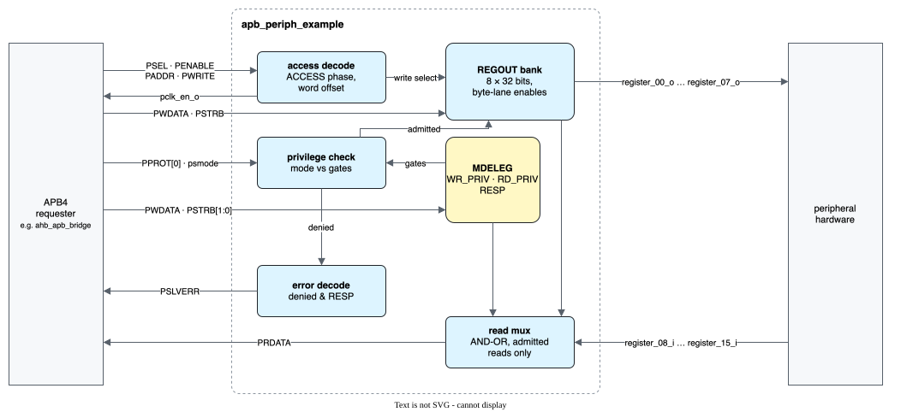
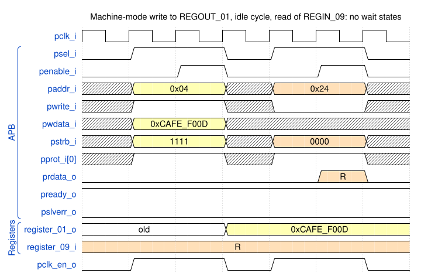
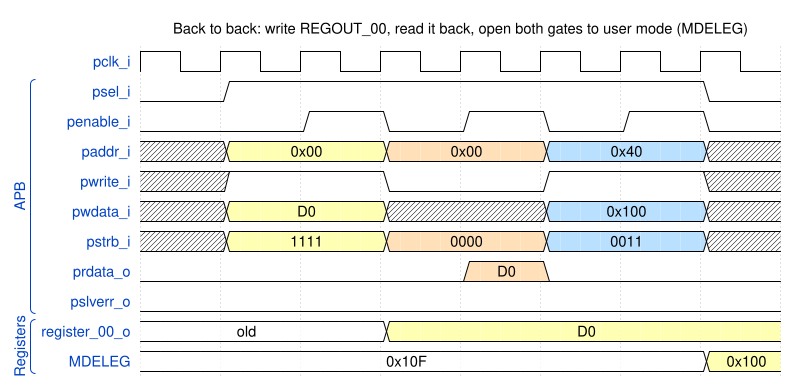
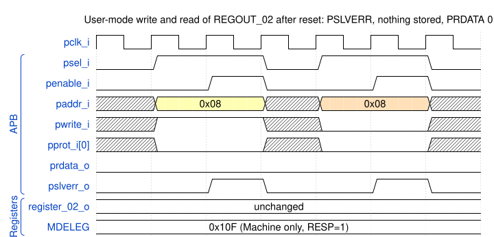

<p align="center">
  
</p>

# APB Peripheral Example

*Reference APB4 completer wiring 8 read-write + 8 read-only 32-bit
registers, with an `MDELEG` privilege-delegation register that gates
access by the requester's privilege level (User / Supervisor / Machine).
The starting template for peripherals placed behind
[`ahb_apb_bridge`](../../ahb_apb_bridge/doc/ahb_apb_bridge.md).*

---

## Contents

- [Overview](#overview)
  - [Design parameters](#design-parameters)
  - [Register map](#register-map)
  - [`MDELEG` register layout](#mdeleg-register-layout)
  - [Privilege model](#privilege-model)
  - [Access outcomes](#access-outcomes)
- [Architecture](#architecture)
  - [Block diagram](#block-diagram)
  - [Family rules and this example's choices](#family-rules-and-this-examples-choices)
  - [Datapath](#datapath)
  - [Extending the register map](#extending-the-register-map)
- [Port summary](#port-summary)
- [Integration requirements](#integration-requirements)
- [Lint waivers](#lint-waivers)
- [Operation](#operation)
- [Software](#software)
- [Repository layout](#repository-layout)
- [Verification](#verification)
- [Synthesis](#synthesis)
- [License](#license)

---

## Overview

The **`apb_periph_example`** module is a minimal APB4 completer used as
the reference for aRVern peripherals on APB. It has the register map and
the privilege model of
[`ahb_periph_example`](../../ahb_periph_example/doc/ahb_periph_example.md),
so the two differ only in the bus interface: the register map and the
`MDELEG_RST` parameter are the same, and the C drivers differ only by
their prefix. It exposes:

- **8 read-write 32-bit registers** (`REGOUT_00` … `REGOUT_07`) driven
  out of the IP as `register_00_o` … `register_07_o` (typical use:
  configuration and control bits).
- **8 read-only 32-bit registers** (`REGIN_08` … `REGIN_15`) read
  combinationally from `register_08_i` … `register_15_i` (typical use:
  status and event flags driven by peripheral hardware).
- **1 privilege-delegation register** (`MDELEG`) that gates access by the
  requester's privilege level and optionally answers a refused access
  with `PSLVERR`.

APB holds the address, the control signals and the write data stable from
the SETUP phase to the end of the ACCESS phase, so the completer decodes
the transfer straight from the bus: it has no data-phase registers, only
the registers it exposes and `MDELEG`. Every transfer completes in its
first ACCESS cycle (`PREADY` is always high). A write takes effect at the
end of the ACCESS cycle, on the byte lanes `PSTRB` selects; `PRDATA` and
`PSLVERR` are valid during the ACCESS cycle and 0 at any other time.

Behind `ahb_apb_bridge`, a `PSLVERR` becomes the AHB ERROR response of the
transfer that caused it: an aRVern hart takes it as a resumable data-bus
NMI (`mncause = 0x80000003`, faulting address in `marv_eaddr`), never as a
load/store access fault (core
[`memory_and_ahb.md`](https://github.com/Arvern-Silicon/arvern/blob/main/doc/memory_and_ahb.md),
section 7).

### Design parameters

The parameter checks are `$fatal` blocks under `translate_off`: they stop
a simulation or lint build at elaboration, and synthesis does not run
them.

| Parameter      | Default | Range      | Purpose |
|----------------|---------|------------|---------|
| `ADDRW`        | `7`     | `>= 7`     | APB address width; the register window is `1<<ADDRW` bytes. Below 7 the `MDELEG` offset (`0x40`) would fall outside the window. Checked by `CHECK_ADDRW`. |
| `ASYNC_RST_EN` | `1`     | `0` or `1` | Reset style: `1` = asynchronous active-low reset (default); `0` = synchronous reset. Threaded to every flop through the shared `arv_ipdff` primitive (see the repository README's [Reset architecture](../../README.md#reset-architecture)). Checked by `CHECK_ASYNC_RST_EN`. |
| `MDELEG_RST`   | `9'h10F` | 9 bits, see purpose | Reset value of `MDELEG[8:0]`: Machine mode only and `PSLVERR` by default. Bits `[7:4]` must be 0 and neither privilege field may hold the reserved `2'b10` (checked by `CHECK_MDELEG_RST`). A wider override is truncated to 9 bits before the check sees it. |

### Register map

17 word-aligned registers in a window of `1<<ADDRW` bytes: 128 bytes at
the default `ADDRW = 7`, which is also the minimum, since `MDELEG` sits at
offset `0x40`. The map is the AHB example's.

| Offset | Name        | Access | Reset      | Description                                            |
|-------:|-------------|--------|-----------:|--------------------------------------------------------|
| `0x00` | `REGOUT_00` | RW     | `0x0000_0000` | Drives `register_00_o[31:0]`                        |
| `0x04` | `REGOUT_01` | RW     | `0x0000_0000` | Drives `register_01_o[31:0]`                        |
| `0x08` | `REGOUT_02` | RW     | `0x0000_0000` | Drives `register_02_o[31:0]`                        |
| `0x0C` | `REGOUT_03` | RW     | `0x0000_0000` | Drives `register_03_o[31:0]`                        |
| `0x10` | `REGOUT_04` | RW     | `0x0000_0000` | Drives `register_04_o[31:0]`                        |
| `0x14` | `REGOUT_05` | RW     | `0x0000_0000` | Drives `register_05_o[31:0]`                        |
| `0x18` | `REGOUT_06` | RW     | `0x0000_0000` | Drives `register_06_o[31:0]`                        |
| `0x1C` | `REGOUT_07` | RW     | `0x0000_0000` | Drives `register_07_o[31:0]`                        |
| `0x20` | `REGIN_08`  | RO     | —          | Reads `register_08_i[31:0]`                          |
| `0x24` | `REGIN_09`  | RO     | —          | Reads `register_09_i[31:0]`                          |
| `0x28` | `REGIN_10`  | RO     | —          | Reads `register_10_i[31:0]`                          |
| `0x2C` | `REGIN_11`  | RO     | —          | Reads `register_11_i[31:0]`                          |
| `0x30` | `REGIN_12`  | RO     | —          | Reads `register_12_i[31:0]`                          |
| `0x34` | `REGIN_13`  | RO     | —          | Reads `register_13_i[31:0]`                          |
| `0x38` | `REGIN_14`  | RO     | —          | Reads `register_14_i[31:0]`                          |
| `0x3C` | `REGIN_15`  | RO     | —          | Reads `register_15_i[31:0]`                          |
| `0x40` | `MDELEG`    | RW (M-mode only) | `MDELEG_RST` (`0x0000_010F`) | Privilege-delegation register (see below) |

Offsets above `MDELEG` are unmapped: an admitted access there reads 0,
its write is ignored, and it gets no `PSLVERR`, because a `PSLVERR`
reaches the hart as an NMI, which is out of proportion for a read of a
reserved offset. A refused access follows `RESP`, as at any offset. The bridge reports a missing completer with an ERROR; the
completer does not report a missing register. `PADDR[1:0]` is not
decoded: an address inside a register word selects that register, and
`PSTRB` alone selects the byte lanes.

### `MDELEG` register layout

```
 31                 9    8    7              4    3       2    1       0
+--------------------+------+----------------+------------+------------+
|     reserved (0)   | RESP |  reserved (0)  |  RD_PRIV   |  WR_PRIV   |
+--------------------+------+----------------+------------+------------+
```

| Field      | Bits   | Reset | Access     | Description |
|------------|--------|-------|------------|-------------|
| `WR_PRIV`  | `[1:0]` | `MDELEG_RST[1:0]` (`2'b11`) | RW (M-mode) | Minimum privilege level for a write to be admitted (at any offset but `MDELEG`). `00` = User, `01` = Supervisor, `10` = *reserved*, `11` = Machine. |
| `RD_PRIV`  | `[3:2]` | `MDELEG_RST[3:2]` (`2'b11`) | RW (M-mode) | Minimum privilege level for a read to be admitted (at any offset but `MDELEG`). Same encoding as `WR_PRIV`. |
| `RESP`     | `[8]`   | `MDELEG_RST[8]` (`1'b1`)  | RW (M-mode) | If `1`, a refused access is answered with `PSLVERR`, at any offset in the window. If `0`, it is dropped silently (writes ignored, reads return `0`). |
| reserved   | `[7:4]`, `[31:9]` | `0` | RO | Reads as zero; writes ignored. `[7:4]` is kept for a second gate pair (see [Extending the register map](#extending-the-register-map)). |

With the default reset value (`MDELEG = 0x0000_010F`) only Machine mode
may access the registers, and any other access gets `PSLVERR`.
Machine-mode firmware opens them by writing smaller `WR_PRIV` /
`RD_PRIV` values and, if wanted, clearing `RESP`. A build that must
come out of reset open sets `MDELEG_RST` instead.

**Why `RESP` exists.** Behind the bridge a `PSLVERR` is an NMI on the
hart, taken in Machine mode only. When an S-mode kernel lets U-mode
tasks use the peripheral, it cannot handle their refused accesses
itself, so Machine-mode firmware clears `RESP` and those accesses are
dropped silently instead.

**Writing `MDELEG`.** A field written with the reserved code `2'b10`
stores `2'b11`. The byte lanes qualify the write: `PSTRB[0]` updates
`WR_PRIV` and `RD_PRIV` together, `PSTRB[1]` updates `RESP`, `PSTRB[3:2]`
nothing. A new value is in force from the next transfer on.

**`MDELEG` itself** is accessible in Machine mode only, whatever its
`WR_PRIV` / `RD_PRIV` content: no less-privileged requester can lock
Machine mode out. A refused access to `MDELEG` follows `RESP` like any
other. `MDELEG` has no lock bit: Machine mode can rewrite it at any time,
and sealing a configuration until the next reset is not a goal of the
family.

### Privilege model

The requester's privilege level is decoded from `PPROT[0]` and the
aRVern supervisor-mode sideband `psmode_i`, exactly as `ahb_apb_bridge`
produces them from `HPROT[1]` and `HAUSER`:

| `pprot_i[0]` | `psmode_i` | Privilege   | Internal encoding |
|:------------:|:----------:|-------------|:--------:|
| `0`          | `x`        | **User**       | `2'b00`  |
| `1`          | `0`        | **Machine**    | `2'b11`  |
| `1`          | `1`        | **Supervisor** | `2'b01`  |

A transfer is admitted when its privilege is **greater than or equal
to** the gate (`WR_PRIV` for writes, `RD_PRIV` for reads):
`User (0) < Supervisor (1) < Machine (3)`. `PPROT[1]` (non-secure) and
`PPROT[2]` (instruction) are not used.

One write gate and one read gate cover every register of the window.
A peripheral whose registers need different owners (for example a data
register open to User mode beside a configuration register kept for
Supervisor) uses the second gate pair that `MDELEG[7:4]` is reserved
for.

### Access outcomes

A **refused** access is one whose privilege is below the gate, or, at
`MDELEG`, one from any mode but Machine. The decision does not depend on
the offset, so a requester below the gate gets the same answer at every
offset in the window, unmapped and read-only included, and a refused
read returns 0: it learns nothing of any register's content.

| Offset | Admitted write | Admitted read | Refused, `RESP = 1` | Refused, `RESP = 0` |
|---|---|---|---|---|
| `REGOUT_*` | Stored on the `PSTRB` lanes | Register value | `PSLVERR`; nothing stored; `PRDATA = 0` | Nothing stored; `PRDATA = 0` |
| `REGIN_*` | No effect (read-only) | `register_XX_i` | `PSLVERR`; `PRDATA = 0` | `PRDATA = 0` |
| `MDELEG` (Machine mode only) | Fields updated as described above | `MDELEG` value | `PSLVERR`; nothing stored; `PRDATA = 0` | Nothing stored; `PRDATA = 0` |
| Unmapped (above `0x40`) | No effect | `0x0000_0000` | `PSLVERR`; `PRDATA = 0` | `PRDATA = 0` |

---

## Architecture

### Block diagram



Every block but the registers is combinational: the access decode, the
privilege check, the error decode and the read mux all work on the APB
signals of the transfer in progress.

### Family rules and this example's choices

A new peripheral copied from this IP keeps the structures in the left
column; they are what every aRVern IP shares and what the family's lint
flows and waivers assume. The right column is this example's content.

| Family rule (keep when copying) | This example's choice |
|---|---|
| Every flop is an `arv_ipdff` instance with `.ARST_EN(...)`; no module writes its own reset block. | 8 RW (`REGOUT_*`) + 8 RO (`REGIN_*`) 32-bit registers. |
| A transfer acts only in its ACCESS cycle (`psel_i & penable_i`); nothing happens in SETUP. | `MDELEG` at offset `0x40`, hence the 128-byte minimum window. |
| `MDELEG`, with this layout, is the word after the last data register; software takes its offset from the peripheral's register header. | `MDELEG_RST` defaults to Machine mode only with `PSLVERR`. |
| `PSLVERR` and `PRDATA` are 0 outside the ACCESS cycle; `PSTRB` selects the written lanes and is ignored on reads. | The `MDELEG` bit layout (`WR_PRIV`, `RD_PRIV`, `RESP`). |
| Every clock the IP uses is requested through an exported enable that is high in every cycle in which one of its flops may load; the SoC gates the clock, and no ICG sits inside the IP (`apb_gpio`'s always-on input path is the recorded exception). During reset the reset generator requests the clock. | `pclk_en_o = psel_i`, combinational: the registers load only in a selected transfer. No wait states: `pready_o` tied high. |
| Privilege is `{pprot_i[0], psmode_i}` decoded to `11 / 01 / 00` and compared `>=` against the gate; the control register is M-only; refusal applies at every offset; a refused read returns 0. | Word-offset localparams and a decoder with one slot per register. |
| Every unconsumed input bit and dead strobe is sunk into a `_unused` wire; the file is bracketed by `` `default_nettype none `` … `` `default_nettype wire ``. | |

### Datapath

- **Access decode**
  ```
  acc_valid = psel_i & penable_i
  acc_write = acc_valid &  pwrite_i
  acc_read  = acc_valid & ~pwrite_i
  acc_addr  = paddr_i[ADDRW-1:2]
  ```
  `reg_dec` has one slot per register (`REGOUT_00` … `MDELEG`); `reg_wr` /
  `reg_rd` qualify it with `acc_write` / `acc_read`. An unmapped offset
  selects no slot: no write enable, no read term.
- **Privilege check**
  ```
  machine_mode    = pprot_i[0] & ~psmode_i
  supervisor_mode = pprot_i[0] &  psmode_i
  privilege_mode  = M ? 2'b11 : S ? 2'b01 : 2'b00
  reg_wr_allowed  = privilege_mode >= mdeleg_wr_priv
  reg_rd_allowed  = privilege_mode >= mdeleg_rd_priv
  ```
- **Register bank** — each `REGOUT_*` byte is an `arv_ipdff` loaded when
  its register is written, the write is admitted and its `PSTRB` bit is
  set. `MDELEG`'s two fields load on `PSTRB[0]` and `PSTRB[1]` of a
  Machine-mode write.
- **Read mux** — an OR of ANDs gating each register by its read slot and
  `reg_rd_allowed` (Machine mode for `MDELEG`), so `PRDATA` is 0 outside a
  read ACCESS cycle and for every refused read.
- **Error decode** — `pslverr_o` is a refused access in its ACCESS cycle
  with `RESP = 1`, combinational like the rest.
- **Clock request** — `pclk_en_o = psel_i`.

### Extending the register map

To add a register: give it the word offset after the last data
register and move `MDELEG` up one word. The decoder, the register bank
and the read mux are sized from the offset localparams (`REGOUT_NR`,
`REGIN_NR`), so a register added to a bank needs only its port and the
port's `assign`. Keep `reg_dec_unused` on the write slots without a
register behind them, and update the `MDELEG` offset in the driver's
register header. An `MDELEG`
above `0x7C` raises the minimum `ADDRW` and the bound in `CHECK_ADDRW`.

To give some registers their own owner, add the second gate pair in
`MDELEG[7:4]` (two more `arv_ipdff` fields, coerced like the first) and
a per-slot constant choosing which pair a register's `reg_wr_allowed` /
`reg_rd_allowed` term uses. Take their reset values from
`MDELEG_RST[7:4]`, and change `CHECK_MDELEG_RST` to check those bits
for the reserved code instead of requiring them to be 0.

A register that needs time to answer drives `pready_o` low until its
data is ready: the bridge adds one AHB wait state per cycle.

---

## Port summary

| Direction | Port            | Width | Description |
|-----------|-----------------|-------|-------------|
| in        | `pclk_i`        | 1     | Module clock (the bridge's `HCLK`) |
| in        | `presetn_i`     | 1     | Active-low reset; assertion style per `ASYNC_RST_EN` |
| out       | `pclk_en_o`     | 1     | Clock-gate enable; drives an integrator-supplied ICG cell |
| in        | `psel_i`        | 1     | Completer select |
| in        | `penable_i`     | 1     | ACCESS phase |
| in        | `paddr_i`       | `ADDRW` | Byte offset within the `1<<ADDRW`-byte window; bits `[1:0]` not used |
| in        | `pwrite_i`      | 1     | Write |
| in        | `pwdata_i`      | 32    | Write data |
| in        | `pstrb_i`       | 4     | Write strobes; not used on reads |
| in        | `pprot_i`       | 3     | Protection; only bit `[0]` (privileged) is used |
| in        | `psmode_i`      | 1     | Supervisor-mode sideband, with the timing of `PPROT` |
| out       | `prdata_o`      | 32    | Read data, in the ACCESS cycle of an admitted read; 0 otherwise |
| out       | `pready_o`      | 1     | Always 1 |
| out       | `pslverr_o`     | 1     | Refused access with `RESP = 1`, in its ACCESS cycle |
| out       | `register_00_o` … `register_07_o` | 32 each | RW register outputs |
| in        | `register_08_i` … `register_15_i` | 32 each | RO register inputs, read combinationally; synchronous to the free-running clock `pclk_i` is gated from |

---

## Integration requirements

- **Behind the bridge** — connect the completer to one `ahb_apb_bridge`
  completer port: `psel_o[k]`, the shared `penable_o`, `paddr_o`,
  `pwrite_o`, `pwdata_o`, `pstrb_o`, `pprot_o`, `psmode_o`, and its
  `prdata_o` / `pready_o` / `pslverr_o` into lane `k`. Give it a bridge
  window of `1<<ADDRW` bytes (`SLV_AW[k] = ADDRW`) and connect the low
  `ADDRW` bits of `paddr_o`. A larger bridge window repeats the register
  window across it, since the upper address bits are not connected. Any other APB4 requester works the
  same way.
- **Reset (`presetn_i`)** — active-low. With `ASYNC_RST_EN = 1` assertion
  takes effect immediately. With `ASYNC_RST_EN = 0` it is sampled on a
  rising `pclk_i` edge: the reset generator requests the clock during
  reset so a gated clock delivers that edge (`pclk_en_o` does not).
  De-assertion must be synchronised by the integrator to the
  free-running clock that `pclk_i` is gated from: an idle completer's
  `pclk_i` has no edges. Behind the bridge, `presetn_i` is the bridge's
  `hresetn_i`.
- **Clock gating (`pclk_en_o` → `pclk_i`)** — a combinational enable,
  high from the SETUP cycle to the end of the transfer. It must reach a
  latch-based ICG cell un-registered. The IP is equally correct on a
  free-running clock.
- **`register_08_i` … `register_15_i`** — combinational into `prdata_o`,
  so synchronous to `pclk_i`. Synchronise any other source first, on the
  free-running clock: a synchroniser on the gated `pclk_i` does not run
  while the completer is idle.
- **`psmode_i`** — tie to `1'b0` with a requester that has no
  supervisor-mode sideband: the completer then sees User and Machine
  only.
- **Reset defaults are Machine-mode locked** — Machine-mode firmware
  programs `MDELEG` before lower-privilege code uses the peripheral. To
  ship it open, set `MDELEG_RST` (for example `9'h000`: every mode
  admitted, no `PSLVERR`).

---

## Lint waivers

Same `_unused` convention as the rest of the family: every deliberately
unconsumed signal is sunk into a wire whose name ends in `_unused`, and
the lint flows exempt those by name (`waive_hdl … -filter
{Signal=~*_unused*}` in `lint/vc_static/waivers.tcl`; Verilator's default
`--unused-regexp`).

| Sink wire        | What it absorbs and why |
|------------------|-------------------------|
| `paddr_unused`   | `paddr_i[1:0]`: registers are words; `PSTRB` selects the lanes. |
| `pprot_unused`   | `pprot_i[2:1]`: the instruction and non-secure attributes do not apply to a register file. |
| `reg_dec_unused` | The write slots of the read-only `REGIN_*` bank. |

---

## Operation

A Machine-mode write to `REGOUT_01`, an idle cycle, then a read of
`REGIN_09`. `register_01_o` takes the new value at the end of the write's
ACCESS cycle; `PRDATA` carries the read data in the read's ACCESS cycle
only.



Transfers back to back, each SETUP in the cycle after the previous
ACCESS: a write, the read of the same register, then a Machine-mode
`MDELEG` write opening both gates to User mode (`PSTRB = 0011`). The new
gates apply from the next transfer on.



After reset with the default `MDELEG_RST`, a User-mode write and read of `REGOUT_02`: both refused,
answered with `PSLVERR` in their ACCESS cycle, nothing stored and
`PRDATA = 0`. With `RESP = 0` the same transfers end without `PSLVERR`.



To regenerate the waveform SVGs, run `python3 render.py` in `doc/img/`;
the block diagram is a draw.io file embedded in its SVG.

---

## Software

`sw/` is the bare-metal C driver: `apb_periph_example_regs.h` (the
register overlay) and `apb_periph_example.h` / `src/apb_periph_example.c`
(binding, register bank accessors, `MDELEG` gates). It mirrors the AHB
example's driver with an `apb_periph_` prefix, so both can be linked into
one application; see [`sw/README.md`](../sw/README.md).

---

## Repository layout

```
apb_periph_example/
  rtl/verilog/       apb_periph_example.v, filelist.f
  bench/verilog/     tb_apb_periph_example.v (manager, reference model, checks), submit.f
  sim/rtl_sim/       bin/ (flow scripts, rtl_configs.py, sim_configs.py), run/, src/ (tests)
  lint/vc_static/    VC Static signoff lint
  synthesis/synopsys Design Compiler flow
  sw/                C driver
  doc/               this document; img/ holds the draw.io block diagram (editable SVG),
                     the WaveDrom sources (*.json), their SVG and render.py
```

---

## Verification

The bench drives the completer from an APB4 manager that runs transfers
back to back or separated by idle cycles, with random `PENABLE`,
address, data, strobe and protection values on the bus whenever no
transfer is running (behind the bridge, a deselected completer sees the
other completers' ACCESS cycles), and random `PSTRB` on reads.
A reference model of the registers and `MDELEG` predicts every `PRDATA`,
every `PSLVERR`, and the value of every register output in every cycle,
so a write landing anywhere but at the end of its ACCESS cycle fails the
test. Checkers require `PREADY` high, and `PSLVERR` and `PRDATA` at 0
outside an ACCESS cycle. The bench clock is gated by `pclk_en_o`, plus
the reset generator's request during reset; the `free_clk` build runs it
ungated, so a register load outside a selected transfer would land and
fail the check.

```bash
cd sim/rtl_sim/run
./run <test>          # one test, default configuration
./run_all             # the regression on the default configuration
./run_all -sweep      # every test on every configuration (bin/sim_configs.py)
./run_all -cov        # Verilator line / branch / toggle coverage
./run_lint -sweep     # Verilator lint on every parameter set (bin/rtl_configs.py)
```

| Test | Checks |
|---|---|
| `simple_rdwr` | `MDELEG` reset value; word write and read of every `REGOUT`; read of every `REGIN` |
| `rw_data_walk` | walking ones and zeros through every `REGOUT` |
| `ro_input_walk` | walking ones and zeros on every `REGIN` input; writes to `REGIN` change nothing |
| `strobes` | every `PSTRB` pattern, zero included, on every `REGOUT` |
| `mdeleg_lanes` | `MDELEG` lanes (`PSTRB[0]` gates, `PSTRB[1]` `RESP`), reserved code stored as Machine, reserved bits |
| `mdeleg_access` | `MDELEG` refused to Supervisor and User whatever the gates, with and without `RESP` |
| `mdeleg_reset` | `MDELEG` reads `MDELEG_RST` after reset, its gates apply from the first transfer in every mode, and a reset restores it after a rewrite |
| `priv_levels` | every gate level, both `RESP` values, every mode, on `REGOUT` and `REGIN`; `PSLVERR` stated independently of the model |
| `unmapped` | every offset above `MDELEG`: no effect, read 0, `PSLVERR` only below the gate; `PADDR[1:0]` ignored |
| `pprot_ignored` | `PPROT[2:1]` change nothing in any mode or gate level |
| `back_to_back` | transfers with no idle cycle, `MDELEG` changes taking effect on the next transfer, 300 random transfers in one stream |
| `setup_commit` | registers unchanged after the SETUP edge, updated after the ACCESS edge |
| `reset_mid_transfer` | reset during ACCESS and during SETUP: the write is lost, every register and `MDELEG` reset |
| `clock_request` | `pclk_en_o` follows `PSEL`: low when idle, high in SETUP and ACCESS, no reset term |
| `random_traffic` | 2000 random transfers: modes, offsets, strobes, `PPROT[2:1]`, `MDELEG` reprogramming, `REGIN` changes, back-to-back runs and idle gaps |

The sweep runs the fifteen tests on five builds (default, `ADDRW = 8`,
synchronous reset, `MDELEG_RST = 9'h001`, which differs from the default
in every field, and an ungated clock), with twenty functional cover bins
that must all be hit. Coverage is 100 % of lines, branches and toggles, with the toggle
points constant by construction (the reserved `MDELEG` bits and
`pready_o`) waived in `sim/rtl_sim/run/waivers_cov.md`.

---

## Synthesis

The Design Compiler flow lives under `synthesis/synopsys/` and uses the
family's `LIB_FLAVOR` mechanism. `libraries/setup_lib_default.tcl` names
your technology: create it from the tracked `setup_lib_example.tcl`
before the first run.

```bash
cd synthesis/synopsys
./run_syn                          # default flavor (lib_default)
./run_syn -rtl_config <N|name>     # one entry of sim/rtl_sim/bin/rtl_configs.py
./run_syn -rtl_sweep               # every entry
./run_check_reset_style            # every flop of the netlist in the expected reset style
```

The default configuration is about 3.5 kGates (NAND2 equivalent) with
the asynchronous reset and 3.1 kGates with the synchronous one, nearly
all of it the 261 register flops (`REGOUT_*` and `MDELEG`); the bus
interface adds no flop. A wider window costs a few gates of decode.

---

## License

BSD 3-Clause — see [`LICENSE`](../../LICENSE) at the repo root.
