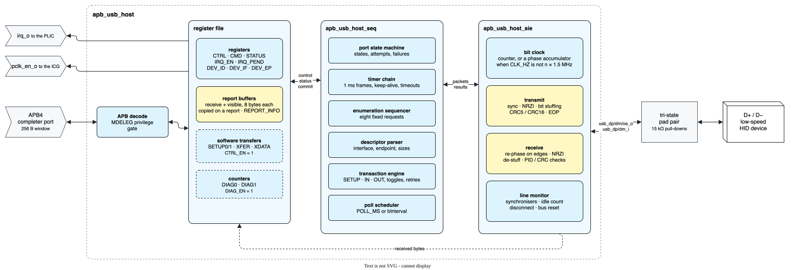
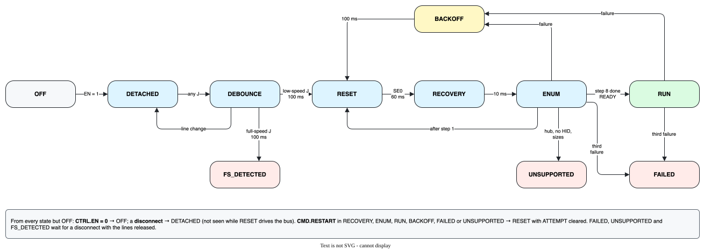
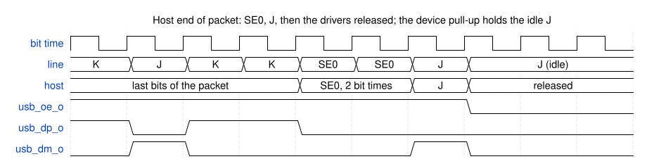
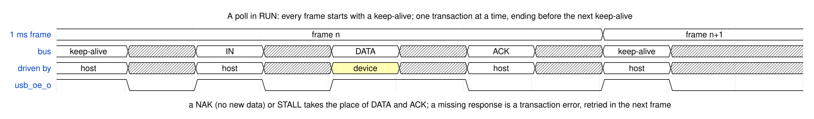
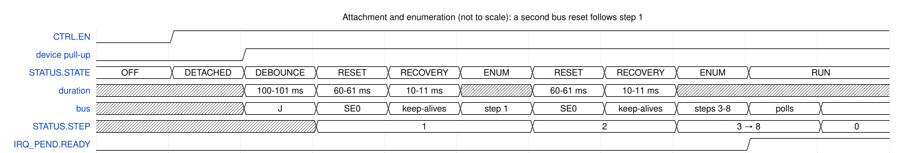
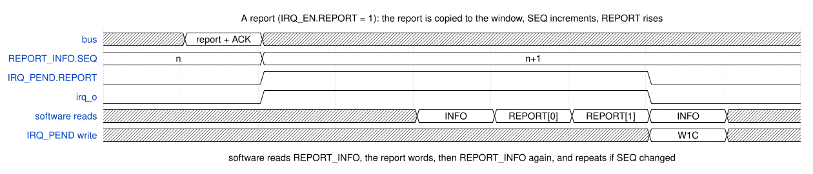
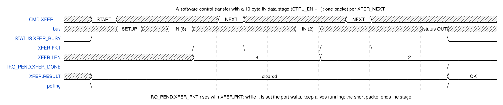
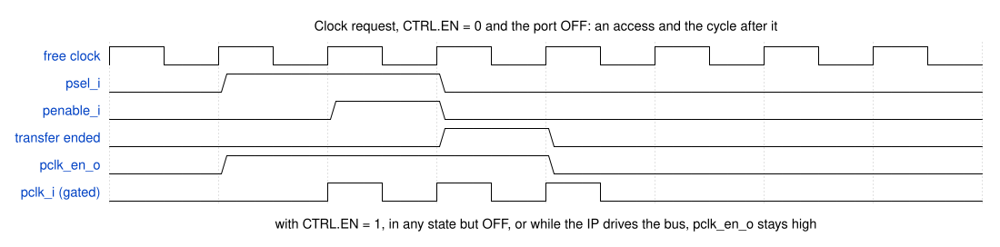

<p align="center">
  
</p>

# apb_usb_host

*A compact USB host for one low-speed HID device (keyboard, mouse, gamepad), with
hardware enumeration and raw report delivery, on an APB4 completer port.*

`apb_usb_host` drives one USB port directly from two FPGA or ASIC pads, with no external
USB PHY. It detects the attachment of a device, resets the bus, enumerates the device in
hardware (no software stack), selects its first HID interface with an interrupt IN
endpoint, then polls that endpoint and hands every report to software as raw bytes:
interpreting the report (key codes, buttons, axes) is the job of the software layer,
which the IP ships as a helper (*Software*).

Robustness is the main design goal. Every state of the port has a bounded duration or
waits for a named event, a fault in any transaction leads to a bounded retry, a failed
enumeration to a bus reset and a new attempt, and a device that keeps failing ends in a
reported failure state that a detach, a software restart or a disable leaves. The IP
comes out of reset with the bus lines released, so a device still configured by a
previous run of the system is reset and enumerated again like a new one.

Area is the second goal. With the default parameters the IP is one serial engine shared
by transmit and receive, one timer chain, one enumeration sequencer and a 16-byte report
buffer. Software-issued control transfers and diagnostic counters are build options
(*Parameters*).

The bus speed is low speed (1.5 Mb/s). Full speed (12 Mb/s) is a reserved option
(`FS_EN`) for system clocks fast enough to sample it; the register map already has the
field widths and windows full speed needs (*Register map*), and *Structure* lists what
full speed changes.

Access is gated by privilege level with an `MDELEG` register, as in
[`apb_periph_example`](../../apb_periph_example/doc/apb_periph_example.md). The bus port is
APB4, for a place behind [`ahb_apb_bridge`](../../ahb_apb_bridge/doc/ahb_apb_bridge.md).

Out of scope: hubs, more than one device per port, full-speed devices with `FS_EN = 0`,
high speed (480 Mb/s needs a ULPI/UTMI PHY), isochronous and bulk endpoints, interrupt
OUT endpoints, alternate interface settings, suspend and remote wake-up, VBUS switching
and over-current detection (board-level functions, a GPIO of the SoC), and HID
report-descriptor parsing in hardware.



---

## Parameters

| Parameter | Default | Range | Meaning |
|---|---|---|---|
| `CLK_HZ` | `48000000` | see below | Frequency of `pclk_i` in Hz. Every bus timing (bit time, response timeout, frame, reset, debounce) is derived from it at elaboration. |
| `FS_EN` | `0` | 0 | Full-speed support. `1` is reserved and does not build. With `0`, a full-speed device is detected and reported (`STATUS.FS_DEV`), never driven. |
| `CTRL_EN` | `0` | 0, 1 | Software control transfers present (*Control transfers*). `0`: `XFER`, `SETUP0/1` and the `XDATA` window read 0, the commands that use them are ignored. |
| `DIAG_EN` | `0` | 0, 1 | Diagnostic counters present (`DIAG0`, `DIAG1`). `0`: they read 0. |
| `ADDRW` | `8` | 8–16 | APB address width; the register window is `1 << ADDRW` bytes. 8 is the smallest window that holds `MDELEG` at `0xC0`. |
| `MDELEG_RST` | `9'h10F` | see *Access protection* | Reset value of `MDELEG[8:0]`, as in `apb_periph_example`. |
| `ASYNC_RST_EN` | `1` | 0, 1 | Reset style: `1` asynchronous active-low, `0` synchronous. Behaviour is identical. |

`CLK_HZ` must be at least 12 MHz and either a multiple of 1.5 MHz or at least 24 MHz.
The transmit bit clock is made by a phase accumulator whose step is computed at
elaboration: its average rate is within 0.01 % of 1.5 Mb/s at every legal `CLK_HZ`, and
its edges sit on the `pclk_i` grid, so they jitter by up to ±1/`CLK_HZ` when `CLK_HZ` is
not a multiple of 1.5 MHz (*Bus timing*). An illegal `CLK_HZ`, `ADDRW` or `MDELEG_RST`
stops simulation and lint elaboration (checks inside `translate_off`); `FS_EN = 1`
instantiates a module that does not exist, so synthesis stops too.

---

## Ports

| Port | Dir | Width | Meaning |
|---|---|---|---|
| `pclk_i` | in | 1 | APB clock, also the USB timebase (frequency `CLK_HZ`); gated by an external ICG driven by `pclk_en_o` (see *Clock request*) |
| `presetn_i` | in | 1 | Active-low reset, style per `ASYNC_RST_EN`; de-assertion synchronous to `pclk_i`. With `ASYNC_RST_EN = 0` the clock must run during reset (the SoC reset generator requests it) |
| `pclk_en_o` | out | 1 | Clock request for the external ICG (see *Clock request*) |
| `psel_i`, `penable_i`, `paddr_i[ADDRW-1:0]`, `pwrite_i`, `pwdata_i[31:0]`, `pstrb_i[3:0]`, `pprot_i[2:0]`, `psmode_i` | in | | APB4 requester signals and the aRVern S-mode sideband, as in `apb_gpio` |
| `prdata_o[31:0]`, `pready_o`, `pslverr_o` | out | | APB4 completer response; `pready_o` is always 1 |
| `usb_dp_i`, `usb_dm_i` | in | 1 each | D+ and D− as read back from the pads; asynchronous, synchronised inside the IP |
| `usb_dp_o`, `usb_dm_o` | out | 1 each | Values driven on D+ and D− while `usb_oe_o` is high |
| `usb_oe_o` | out | 1 | Output enable of both pads; low = lines released (the device's pull-up and the host pull-downs set the level) |
| `irq_o` | out | 1 | Interrupt: OR of `IRQ_PEND & IRQ_EN` |

`usb_dp_o`, `usb_dm_o` and `usb_oe_o` are flop outputs; they leave reset low (lines
released). The tri-state buffers sit outside the IP. Each data line needs a 15 kΩ
pull-down to ground on the host side, and the pads must be 3.3 V capable; series
resistors (22–33 Ω) are recommended. The input synchronisers reset to 0 (SE0, the empty
port): the transition they show after reset lands in `OFF` or `DETACHED`, where only the
100 ms debounce looks at the lines.

---

## The port

### States

`STATUS.STATE` reports where the port is:

| Value | State | The port is… | Leaves to |
|---|---|---|---|
| 0 | `OFF` | disabled (`CTRL.EN = 0`), lines released | `DETACHED` on `CTRL.EN = 1` |
| 1 | `DETACHED` | released, watching the lines | `DEBOUNCE` on any J (low- or full-speed polarity) |
| 2 | `DEBOUNCE` | waiting for the attachment to be stable for 100 ms | `RESET` after 100 ms of uninterrupted low-speed J; `FS_DETECTED` after 100 ms of uninterrupted full-speed J; `DETACHED` when the lines leave the J they started with |
| 3 | `RESET` | driving the bus reset (SE0) for 60 ms | `RECOVERY` |
| 4 | `RECOVERY` | released, sending keep-alives for 10 ms | `ENUM`; `DETACHED` on a disconnect |
| 5 | `ENUM` | running the enumeration sequence | `RUN`; `BACKOFF` or `FAILED` on a failure; `UNSUPPORTED` |
| 6 | `RUN` | polling the interrupt endpoint | `BACKOFF` or `FAILED` on a failure |
| 7 | `BACKOFF` | lines released for 100 ms after a failure | `RESET` |
| 8 | `FAILED` | released, giving up on this device | `DETACHED` on a disconnect |
| 9 | `UNSUPPORTED` | released; the device is a hub, has no usable HID interface, or does not meet the low-speed rules | `DETACHED` on a disconnect |
| 10 | `FS_DETECTED` | released; a full-speed device is attached (`FS_EN = 0`) | `DETACHED` on a disconnect |



From every state but `OFF`, `CTRL.EN = 0` leads to `OFF` and a disconnect to `DETACHED`.
`CMD.RESTART` in `RECOVERY`, `ENUM`, `RUN`, `BACKOFF`, `FAILED` or `UNSUPPORTED` leads to
`RESET` with `STATUS.ATTEMPT` cleared; it is ignored in `OFF`, `DETACHED`, `DEBOUNCE`,
`RESET` and `FS_DETECTED` (a full-speed device is never driven).

`DEBOUNCE`, `RESET`, `RECOVERY`, `ENUM` and `BACKOFF` are bounded by their timers.
`OFF`, `DETACHED`, `FAILED`, `UNSUPPORTED` and `FS_DETECTED` wait for software or a line
event with the port released. `RUN` lasts as long as the device answers; while a software
control transfer waits for `CMD.XFER_NEXT`, `RUN` waits for software, with keep-alives.
The port has no other waiting state, so no device behaviour can stall it.

### Attempts

A **failure** is a failed enumeration step or a failed poll (*Enumeration*, *Polling*).
`STATUS.ATTEMPT` counts failures since the last proof that the device works: it is
cleared on entry to `DEBOUNCE`, by `CMD.RESTART`, and by the first poll in `RUN` that
the device answers (a report or a NAK). A failure with `ATTEMPT` below 2 increments it
and enters `BACKOFF`; the third failure enters `FAILED` directly, where `ATTEMPT` reads 2. A device that worked
and then fails is enumerated again as a new one; a device that enumerates but never
answers a poll ends in `FAILED`.

### Line state, attachment and disconnect

The synchronised lines read as `STATUS.LINE`. A low-speed device pulls D− high (idle
state J = D− high, D+ low); a full-speed device pulls D+ high. Both lines low (SE0) with
the lines released is a detached port. The speed is decided from a J that has stayed
stable for the whole 100 ms debounce, as the spec decides it from the bus state just
before the reset (USB 2.0 §7.1.7.3); restarting on any change is stricter than
`TATTDB`, and it keeps a low-speed device's resume signalling (K, which has the
full-speed J polarity) from being taken for a full-speed device.

A **disconnect** is SE0 lasting more than 2.25 µs while the host is not driving the bus
(USB 2.0 §7.1.7.3, `TDDIS` 2–2.5 µs). The host's own SE0 is never taken for a disconnect:
detection is masked while `usb_oe_o` is high and re-arms 2.25 µs after the lines are
released. In `RESET` the lines are driven and a detach cannot be seen; a device removed
during the reset is detected in `RECOVERY`.

### Bus timing

Delays between packets are measured from the SE0-to-J transition at the end of one
packet's end-of-packet (EOP) to the J-to-K transition that starts the next (USB 2.0
§7.1.18).

| Item | Value | Requirement (USB 2.0) |
|---|---|---|
| Transmit bit rate | 1.5 Mb/s, average error ≤ 0.01 % | ±0.05 % for hosts (§7.1.11) |
| Transmit edge jitter | 0 when `CLK_HZ` is a multiple of 1.5 MHz, else ±1/`CLK_HZ` (±30 ns at 33.333 MHz, ≤ ±42 ns at 24 MHz and above) | 71 ns (next transition) / 44 ns (paired) for a host directly connected to a low-speed device (§7.1.15.1, Table 7-5); the ±25 / ±10 ns source figures of §7.1.13.1.1 are met by the jitter-free case |
| Attach debounce | 100 to 101 ms of uninterrupted J | `TATTDB` ≥ 100 ms (§7.1.7.3) |
| Bus reset | 60 to 61 ms of SE0 | `TDRSTR` ≥ 50 ms from a root port (§7.1.7.5) |
| Reset recovery | 10 to 11 ms, keep-alives running | `TRSTRCY` ≥ 10 ms (§7.1.7.5) |
| Keep-alive | a low-speed EOP at the start of every 1 ms frame, from `RECOVERY` to the end of `RUN` | at least one per frame (§11.8.4.1); a device suspends after 3 ms of idle bus (§7.1.7.6) |
| Host end of packet | SE0 for 2 bit times, J for 1 bit time, then the drivers released (`usb_oe_o` low) | `TLEOPT` 1.25–1.50 µs (§7.1.13.2) |
| Response timeout | no start of packet within 24 bit times | the host waits at least 18 bit times (§7.1.19.1) |
| Host inter-packet delay | 4 bit times before a data or handshake packet | 2 to 7.5 bit times (§7.1.18) |
| Bus idle before a host packet | 4 consecutive bit samples of undriven J (at least 3 bit times), the line at J when the packet starts | — (*Bus busy*) |
| Recovery after `SET_ADDRESS` | 10 to 11 ms | at least 2 ms (§9.2.6.3) |
| Control-request progress timeout | 500 to 501 ms without progress (*Transactions*) | 500 ms per data packet, 50 ms for the status stage (§9.2.6.4) |
| Failure back-off | 100 to 101 ms, lines released | — |

The port's timers count whole 1 ms frames from the event that starts them, so a duration
of N ms lasts N to N+1 ms: never less than the value, which is what each USB requirement
bounds.



The receiver re-aligns its bit timing on every transition of the line and samples mid-bit,
so a device bit rate within its ±1.5 % tolerance (§7.1.11) is received at any legal
`CLK_HZ`.

### Transactions

The protocol layer runs the SETUP, IN and OUT transactions of USB 2.0 §8.5 with full
packet checking. A received packet is accepted only with a valid sync, a PID whose check
bits match, no bit-stuffing violation, a valid CRC16 and an EOP within the maximum packet
length (8 data bytes at low speed, §8.4.4). A failed check, a missing response, an
unexpected PID or a packet too long is a **transaction error**. A packet whose EOP has
not come by the end of the maximum length is abandoned, and the receiver waits for the
bus to be idle.

- **Bus busy.** The host starts a packet, a keep-alive included, only after the lines
  have been at J, undriven by the host, for 4 consecutive bit samples (at least 3 bit
  times). A keep-alive or a transaction
  due while the bus is not idle is not sent and counts as a transaction error. The bus
  reset is the only host signalling driven whatever the line state. A device that
  babbles or holds the bus therefore ends in `BACKOFF`, a bus reset, and `FAILED` if it
  keeps doing so (USB 2.0 §8.7.4). A device that babbles with gaps of 4 idle bit times can
  still collide with a host packet started in a gap; the collision is a transaction error
  like the others.
- **Retry.** A transaction error is retried in the next frame, which also gives the
  turnaround and the 16 idle bit times the spec requires after a timeout or a corrupted
  packet (§8.7.1, §8.7.3). The third consecutive error fails the enumeration step, the
  poll or the control transfer (§4.5.2).
- **NAK** is not an error: the same transaction is retried in the next frame, until the
  progress timeout during a control transfer, indefinitely while polling (a device with
  no new data answers NAK).
- **STALL** fails an enumeration step (except the optional steps 7 and 8, which a device
  may legally refuse), fails a poll, and ends a software control transfer (*Control
  transfers*).
- **Data toggle** (§8.6). SETUP with DATA0, the data stage from DATA1, alternating, the
  status stage DATA1; the interrupt endpoint starts at DATA0 after `SET_CONFIGURATION`.
  The host advances its expected IN toggle on every accepted data packet, a zero-length
  one included. An IN packet with the wrong toggle is acknowledged and discarded
  (§8.6.4). The host answers a data packet with ACK or not at all.
- **Control transfer stages** (§8.5.3), for the enumeration requests and the software
  ones alike:
  - An IN data stage ends with a short packet (fewer bytes than the maximum, a
    zero-length packet included) or when `wLength` bytes have been received; the port
    also ends step 5 early once its parser has what it needs (*Enumeration*). The status stage is then an OUT with a zero-length DATA1,
    answered by ACK (done), NAK (retried) or STALL.
  - With no data stage (`wLength = 0`) or an OUT data stage, the status stage is an IN;
    the device returns a zero-length DATA1, which the host acknowledges. A DATA0 or
    non-empty packet there is a transaction error.
  - Every stage after the SETUP uses the SETUP's address, including the status stage of
    `SET_ADDRESS`.
- **Progress timeout.** A control transfer fails when 500 ms pass without progress:
  without the device accepting the SETUP, delivering or accepting a data packet, or
  completing the status stage. Time the port spends waiting for software is not counted.
  The spec allows 500 ms per data packet and 50 ms for the status stage; using one 500 ms
  bound for each wait is within it for the data packets and more lenient for the status
  stage.

At most one transaction is in flight. Every frame starts with the keep-alive; a
transaction starts only early enough to finish before the next frame's keep-alive.



### Enumeration

The sequence of fixed requests run by `ENUM`. The device is alone on its port: address 0
until the status stage of `SET_ADDRESS` completes, address 1 from the first token after
the recovery.

| Step | Request | Takes from the answer |
|---|---|---|
| 1 | `GET_DESCRIPTOR(DEVICE)`, `wLength` 8 | `bMaxPacketSize0` (must be 8), `bDeviceClass` (9, a hub, is `UNSUPPORTED`) |
| 2 | a second bus reset and recovery (`RESET`, `RECOVERY`, no new debounce; `STATUS.STATE` shows them) | — |
| 3 | `SET_ADDRESS(1)`, then the 10 ms recovery | — |
| 4 | `GET_DESCRIPTOR(DEVICE)`, `wLength` 18 | `idVendor`, `idProduct` → `DEV_ID` |
| 5 | `GET_DESCRIPTOR(CONFIGURATION)`, `wLength` 255 | `bConfigurationValue`; the selected interface and endpoint (below) → `DEV_IF`, `DEV_EP` |
| 6 | `SET_CONFIGURATION(bConfigurationValue)` | — |
| 7 | `SET_PROTOCOL(boot)` to the interface, if its subclass is boot (1) and `CTRL.BOOT = 1` | `DEV_IF.BOOT` = 1 when accepted |
| 8 | `SET_IDLE(0)` to the interface, if `CTRL.IDLE0 = 1` | — |



Step 2 follows the sequence common hosts use, which cheap devices are tested against.
The host takes the device's first configuration. Step 5 is parsed as it streams in; no
descriptor is stored:

- Descriptors are walked by `bLength`. A `bLength` of 0, or a descriptor running past
  `wTotalLength` or past the 255 bytes requested, is a malformed descriptor. Descriptors
  of other types (the HID descriptor between an interface and its endpoints, class- or
  vendor-specific ones) are skipped.
- The selected interface is the first one with `bInterfaceClass` 3 (HID),
  `bAlternateSetting` 0 and an endpoint with `bEndpointAddress[7]` = 1 (IN) and
  `bmAttributes[1:0]` = 3 (interrupt); the selected endpoint is the first such endpoint of
  that interface.
- The endpoint's `wMaxPacketSize[10:0]` must be 1–8; bits `[15:11]` are ignored. A
  `bInterval` of 0 (illegal) is taken as 1, and `DEV_EP` shows 1.
- The host stops reading once `wTotalLength` bytes have arrived or the endpoint has been
  found, and completes the status stage.
- No selected interface within the bytes read is `UNSUPPORTED`.

Step 7 follows HID 1.11 §7.2.6: devices power up in report protocol, but the host must
set the protocol it wants rather than assume it; boot protocol gives keyboards and mice
the fixed report layout of HID 1.11 Appendix B, which the software helper decodes without
a report descriptor. Gamepads have no boot protocol: their report layout is the software
helper's business (*Software*). Steps 7 and 8 are optional: a STALL, the progress timeout
or three transaction errors end the step and the sequence continues (`DEV_IF.BOOT` stays
0 after a failed step 7).

A failure of steps 1, 3–6 (three transaction errors, a STALL, a malformed descriptor,
the progress timeout) is a failure in the sense of *Attempts*. `STATUS.ERR` and
`STATUS.STEP` record its cause and step. `IRQ_PEND.READY` rises when the sequence completes
and the port enters `RUN`.

### Polling

In `RUN` the port sends an IN token to the interrupt endpoint every `CTRL.POLL_MS`
milliseconds, or every `bInterval` milliseconds when `CTRL.POLL_MS` is 0. Polling faster
than `bInterval` is allowed; the device answers NAK when it has nothing new. A DATA packet
with the expected toggle and at least one byte is a **report**: it is acknowledged,
committed to the report buffer, `REPORT_INFO.SEQ` increments and `IRQ_PEND.REPORT` rises.
A zero-length packet is acknowledged, advances the toggle and is not committed. Three
consecutive transaction errors or a STALL fail the poll (a failure in the sense of
*Attempts*).

Every accepted data packet is one report to software. A device whose report is longer
than `wMaxPacketSize` delivers it as several packets, each committed on its own in order;
the host cannot tell the last one without the report descriptor, so any reassembly is
the software helper's, from its knowledge of the device. The low-speed HID devices this
IP targets send reports of at most 8 bytes in one packet.

### Report buffer

The receiver fills a receive buffer, and a valid report is copied in one cycle to the
visible buffer behind the report window, so the window and `REPORT_INFO` always describe
one complete report. A copy can
still fall between two register reads; software reads `REPORT_INFO`, then the report
words, then `REPORT_INFO` again, and repeats if `SEQ` changed (the driver does this).
Reports arrive at most once per millisecond, so a retry is rare.


 Reads have no side
effect, so a debugger may display the registers freely.

---

## Control transfers

With `CTRL_EN = 1`, software can run its own control transfers to the device while the
port is in `RUN`: an output report to set keyboard LEDs or a rumble motor
(`SET_REPORT`), a string descriptor, the HID report descriptor read packet by packet, a
vendor request. The data stage passes through the `XDATA` buffer one packet at a time
(at most 8 bytes at low speed), with a handshake per packet, so a transfer of any length
needs no larger buffer. The stage rules are those of *Transactions*.

1. Software writes the 8 setup bytes to `SETUP0`/`SETUP1` and sets `CMD.XFER_START`.
   Polling pauses after the poll in progress; `STATUS.XFER_BUSY` rises, `XFER.PKT` and
   `XFER.RESULT` clear. The length of the data stage is `wLength`; its direction is
   `bmRequestType[7]`, ignored when `wLength` is 0 (no data stage, status stage IN).
2. **IN data stage.** Each data packet the device returns, a zero-length one included, is
   placed in the `XDATA` window, `XFER.LEN` gives its length, `XFER.PKT` and
   `IRQ_PEND.XFER_PKT` rise. The port waits, sending keep-alives, until software sets
   `CMD.XFER_NEXT`, which clears `XFER.PKT`; the port then sends the next IN, or moves to
   the status stage once the stage has ended.
3. **OUT data stage.** `XFER.PKT` is set when the stage starts: the buffer is free.
   Software writes a packet to the `XDATA` window and its length to `XFER.LEN`, then sets
   `CMD.XFER_NEXT`, which clears `XFER.PKT` and sends the packet; `XFER.PKT` and
   `IRQ_PEND.XFER_PKT` rise again when the device has accepted it, except after the
   packet that completes the stage. The stage ends after `wLength` bytes, and the status
   stage follows at once; a packet longer than the maximum or than the remaining length
   is sent truncated to the smaller.
4. **Status stage**, then `STATUS.XFER_BUSY` falls, `XFER.RESULT` holds the outcome and
   `IRQ_PEND.XFER_DONE` rises. Polling resumes.



`CMD.XFER_NEXT` while `XFER.PKT` is clear, and `CMD.XFER_NEXT` or `CMD.XFER_ABORT` with no
transfer running, are ignored. `CMD.XFER_ABORT` ends a transfer with `XFER.RESULT =
ABORTED` at the next packet boundary: at once between two transactions (a NAKed one
included, and while the port waits for `CMD.XFER_NEXT`), else when the transaction in
flight ends. A disconnect, `CMD.RESTART` or `CTRL.EN = 0` end it at once with `DETACHED`,
`XFER_BUSY` falling and `IRQ_PEND.XFER_DONE` rising. A STALL ends it with `STALL` and does
not affect polling. Three transaction errors or the progress timeout end it with `ERROR`
and are a failure in the sense of *Attempts*. `CMD.XFER_START` outside `RUN` or while a
transfer runs sets `XFER.RESULT = REFUSED` and `IRQ_PEND.XFER_DONE` at once, and does not
disturb a running transfer.

---

## Clock request

```
pclk_en_o = psel_i | CTRL.EN | (STATUS.STATE != OFF) | usb_oe_o | (a transfer ended on the last edge)
```

The port's timers and the bus engine run from `pclk_i`, so the IP keeps its clock while
the port is enabled, and after `CTRL.EN` is cleared until the port has reached `OFF` with
the lines released and every register effect of leaving its previous state has landed.
With `CTRL.EN = 0`, the port in `OFF` and no transfer, nothing in the IP changes;
`STATUS.LINE` then shows the lines as sampled on the edges an access requests. The
request carries no reset term; the SoC reset generator requests every clock during reset.
`pclk_en_o` must reach the ICG that gates `pclk_i`, as for `apb_i2s`.



---

## Register map

All registers are 32 bits. Offsets not listed read 0 and ignore writes. A write updates
the byte lanes `PSTRB` selects (`IRQ_PEND` W1C and `CMD` act on lane 0). Reads return the
whole word and have no side effect.

| Offset | Name | Access | Reset | Meaning |
|---|---|---|---|---|
| `0x00` | `INFO` | RO | — | `[0]` `FS_EN`, `[1]` `CTRL_EN`, `[2]` `DIAG_EN`, `[31:28]` `VERSION` = 1 |
| `0x04` | `CTRL` | RW | `0x0000_0006` | `[0]` `EN`, `[1]` `BOOT`, `[2]` `IDLE0`, `[15:8]` `POLL_MS` (0 = `bInterval`) |
| `0x08` | `CMD` | WO | — | Write 1 to act: `[0]` `RESTART`, `[1]` `XFER_START`, `[2]` `XFER_NEXT`, `[3]` `XFER_ABORT`; reads 0 |
| `0x0C` | `STATUS` | RO | `0` | `[3:0]` `STATE`, `[5:4]` `LINE` (`{D+, D−}`), `[6]` `FS_DEV`, `[7]` `XFER_BUSY`, `[11:8]` `ERR`, `[13:12]` `ATTEMPT`, `[19:16]` `STEP` |
| `0x10` | `IRQ_EN` | RW | `0` | One enable per `IRQ_PEND` bit |
| `0x14` | `IRQ_PEND` | RO / RW1C | `0` | `[0]` `REPORT`, `[1]` `READY`, `[2]` `DETACH`, `[3]` `FAIL`, `[4]` `XFER_PKT`, `[5]` `XFER_DONE`, `[6]` `STATE` |
| `0x18` | `DEV_ID` | RO | `0` | `[15:0]` `idVendor`, `[31:16]` `idProduct` |
| `0x1C` | `DEV_IF` | RO | `0` | `[7:0]` `bInterfaceNumber`, `[15:8]` `bInterfaceSubClass`, `[23:16]` `bInterfaceProtocol`, `[24]` `BOOT` (boot protocol set) |
| `0x20` | `DEV_EP` | RO | `0` | `[3:0]` endpoint number, `[10:4]` `wMaxPacketSize`, `[23:16]` `bInterval`, `[30:24]` `bMaxPacketSize0` |
| `0x24` | `REPORT_INFO` | RO | `0` | `[6:0]` `LEN` (bytes), `[15:8]` `SEQ` (increments per report, wraps) |
| `0x28` | `XFER` | RW | `0` | `[6:0]` `LEN` (OUT: written by software; IN: set by the port), `[8]` `PKT` (RO), `[11:9]` `RESULT` (RO: 0 OK, 1 STALL, 2 ERROR, 3 ABORTED, 4 DETACHED, 5 REFUSED) |
| `0x2C` | `SETUP0` | RW | `0` | Setup bytes 0–3 (`bmRequestType` in `[7:0]`) |
| `0x30` | `SETUP1` | RW | `0` | Setup bytes 4–7 (`wLength` in `[31:16]`) |
| `0x34` | `DIAG0` | RO / W | `0` | Saturating 8-bit counts: `[7:0]` response timeouts, `[15:8]` CRC / stuffing / PID-check errors, `[23:16]` other transaction errors (unexpected PID, too long, bus busy), `[31:24]` STALLs. A write clears `DIAG0` and `DIAG1` |
| `0x38` | `DIAG1` | RO | `0` | `[15:0]` bus resets since the last clear, `[31:16]` IN packets discarded for a wrong toggle |
| `0x40`–`0x7C` | `REPORT[16]` | RO | `0` | The report window: byte *n* of the report in byte lane *n* mod 4 of `REPORT[n / 4]`; bytes at and beyond `REPORT_INFO.LEN` are unspecified. With `FS_EN = 0` only `REPORT[0]` and `REPORT[1]` exist; the others read 0 |
| `0x80`–`0xBC` | `XDATA[16]` | RW | `0` | The data-stage packet window, laid out like `REPORT`; after an IN packet, bytes at and beyond `XFER.LEN` are unspecified. With `FS_EN = 0` only `XDATA[0]` and `XDATA[1]` exist |
| `0xC0` | `MDELEG` | RW (M-mode only) | `MDELEG_RST` | Access protection (see *Access protection*) |

`STATUS.ERR`, the cause of the last failure (for three transaction errors, the kind of
the third): 0 none, 1 response timeout, 2 CRC /
stuffing / PID check, 3 unexpected PID, packet too long or bus busy, 4 STALL, 5 progress
timeout, 6 malformed descriptor, 7 hub, 8 no usable HID interface, 9 `bMaxPacketSize0`
or `wMaxPacketSize` out of range. `STATUS.STEP`: the enumeration step of that failure
(1, 3–6; 0 for a poll or a software control transfer). Both are cleared by `CMD.RESTART`,
by `CTRL.EN = 0` and on entry to `RUN`; they survive `DETACHED`, so a device that failed
and was unplugged leaves its trace. `STATUS.FS_DEV` is 1 in `FS_DETECTED`, so software sees a
full-speed device without decoding `STATE`.

`IRQ_PEND` causes: `REPORT` a report was committed; `READY` the port entered `RUN`;
`DETACH` a disconnect while the port was in `RUN`; `FAIL` entry into `BACKOFF`, `FAILED`
or `UNSUPPORTED`; `XFER_PKT` and `XFER_DONE` per *Control transfers*; `STATE` any change
of `STATUS.STATE`. A cause set in the same cycle as its W1C stays set.

`DEV_ID`, `DEV_IF` and `DEV_EP` hold the last enumerated device's values until the next
enumeration starts (step 1) or `CTRL.EN` is cleared; software qualifies them with
`STATUS.STATE` (a `READY` handler reads `STATUS` after them). `REPORT_INFO` is
cleared when the port leaves `RUN`: with `LEN` 0 the window holds no report (its bytes are
unspecified). Writing `CTRL` while the port runs
takes effect at the next poll (`POLL_MS`) or the next enumeration (`BOOT`, `IDLE0`).

---

## Access protection

`MDELEG` at `0xC0`, with the layout, encoding and behaviour of
[`apb_periph_example`](../../apb_periph_example/doc/apb_periph_example.md#mdeleg-register-layout):
`WR_PRIV[1:0]`, `RD_PRIV[3:2]`, `RESP[8]`; a refused access changes nothing (a refused
`CMD` write starts nothing), reads 0 and gets `PSLVERR` with `RESP = 1`.

---

## Structure

| Module | Role |
|---|---|
| `apb_usb_host` | APB4 completer, registers, interrupt, report buffer |
| `apb_usb_host_seq` | Port state machine, timer chain, enumeration sequencer and descriptor parser, poll scheduler, control-transfer handshake |
| `apb_usb_host_sie` | Serial engine: line sampling and disconnect detection, NRZI, bit stuffing, CRC5 / CRC16, PID check, packet framing; one shift register for both directions |

Bit timing, the EOP, the response timeout and the inter-packet delays are counted in bit
times inside the serial engine, the only module with a speed-dependent clock constant.
The sequencer holds the speed-dependent protocol choices behind `FS_EN`: the frame
strobe (a keep-alive EOP at low speed, a start-of-frame token at full speed), the packet
size limits (`bMaxPacketSize0`, `wMaxPacketSize`, the received payload), the frame
scheduling budget and the attach polarity. The register map already has the widths and
windows of full speed.

---

## Timing and integration

Every pad output is a flop output and every multiplexer is a flat AND-OR structure, so
the IP has no long path of its own. `usb_dp_i` and `usb_dm_i` land only on synchronisers
and are false paths for STA. The pads are ordinary 3.3 V LVCMOS pads; the edge rate of
low-speed USB (75–300 ns, USB 2.0 §7.1.1.2) is a pad drive-strength and board matter.

## Integration example

**USB-A port of the Sipeed Tang Console 138K**: `usb_dp_i/_o`, `usb_dm_i/_o` and `usb_oe_o`
to a tri-state pad pair per line, the board's 15 kΩ pull-downs, VBUS from the board's
5 V rail. `CLK_HZ` = the system clock, 33 333 333 (transmit edge jitter ±30 ns). One
instance per port, each with its own PLIC source.

---

## Software

`sw/` holds the register map (`apb_usb_host_regs.h`) and a driver (`apb_usb_host.h`,
`src/apb_usb_host.c`, functions prefixed `apb_usb_host_`): enable, state and device
information, report read with the `SEQ` retry, interrupts, control transfers and the
`MDELEG` gates.

`sw/hid/` holds the report decoder: boot keyboard and boot mouse (HID 1.11 Appendix B),
and gamepads by a table keyed by `idVendor`/`idProduct` with a generic layout for unknown
pads. Its interrupt handler, called on `IRQ_PEND.REPORT`, decodes every report as it
arrives: mouse movement is accumulated and keyboard presses and releases are queued, so
an application that reads its input once per frame loses no movement and no keystroke.
A gamepad's state is the latest report.

---

## Verification

The bench drives the IP from an APB4 requester, with the bus clock gated by `pclk_en_o`
alone, and connects the port to a behavioural low-speed device model written from this
document and USB 2.0, not from the RTL:

- the device: programmable descriptors (keyboard, mouse, gamepad, composite device, hub,
  non-HID device, alternate settings, the HID descriptor between interface and endpoint,
  `wTotalLength` a multiple of 8, illegal `wMaxPacketSize` and `bInterval`, a full-speed
  pull-up), its bit rate anywhere within ±1.5 %, its response delay anywhere within the
  legal range; programmed NAK, STALL, silence, CRC and stuffing errors, wrong toggles,
  overlong packets, babble, a bus held at J or K, resume signalling, attach and detach
  at any moment. It answers its new address only after the `SET_ADDRESS` status stage
  and the recovery;
- checks on the host, always on: transmit bit rate and edge jitter against `CLK_HZ`, EOP
  shape and driver release, inter-packet delays, no host packet on a busy bus, packet
  CRCs and stuffing, the bus reset length, the debounce, the keep-alive in every frame
  from the end of the reset, the toggle sequence, the address of every token, no driving
  while detached, `pclk_en_o` against its formula.

The model is first validated against an independent low-speed host before it is used
on this one. Tests cover every state transition, every failure cause at every
enumeration step, every control-transfer path and abort point, the interrupts, the
report buffer under concurrent reads, and the recovery cases: a system reset during the
bus reset, `CTRL.EN` cleared in every state, a device left configured by a previous run,
repeated detach and attach, a device that answers NAK forever, a device that NAKs
`SET_IDLE` forever, a device that stops answering while polled, and transient poll
failures far apart that must not reach `FAILED`. Configurations sweep `CLK_HZ` (12 to
200 MHz, multiples of 1.5 MHz and not), `CTRL_EN`, `DIAG_EN`, `ADDRW`,
`MDELEG_RST` and the reset style.

## Synthesis

The Design Compiler flow lives under `synthesis/synopsys/`, with the family's
`LIB_FLAVOR` mechanism.
